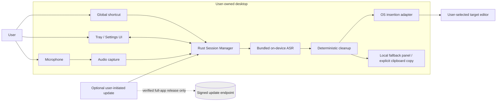
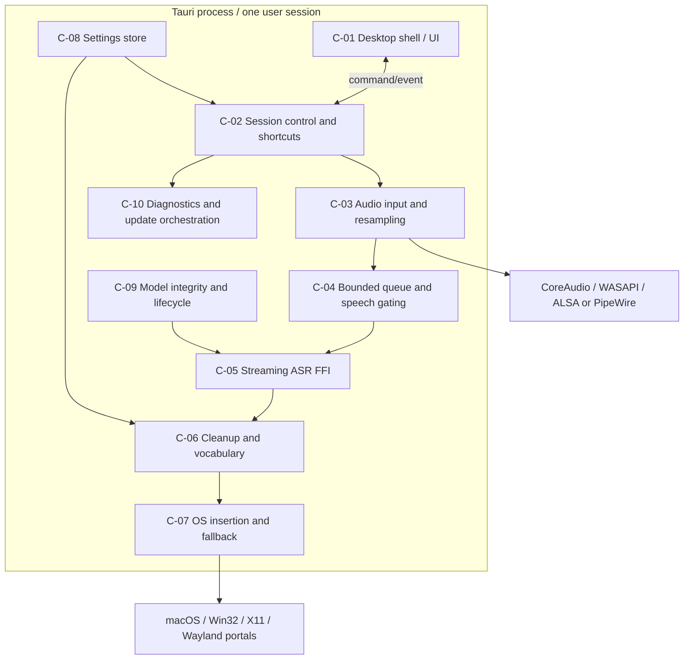
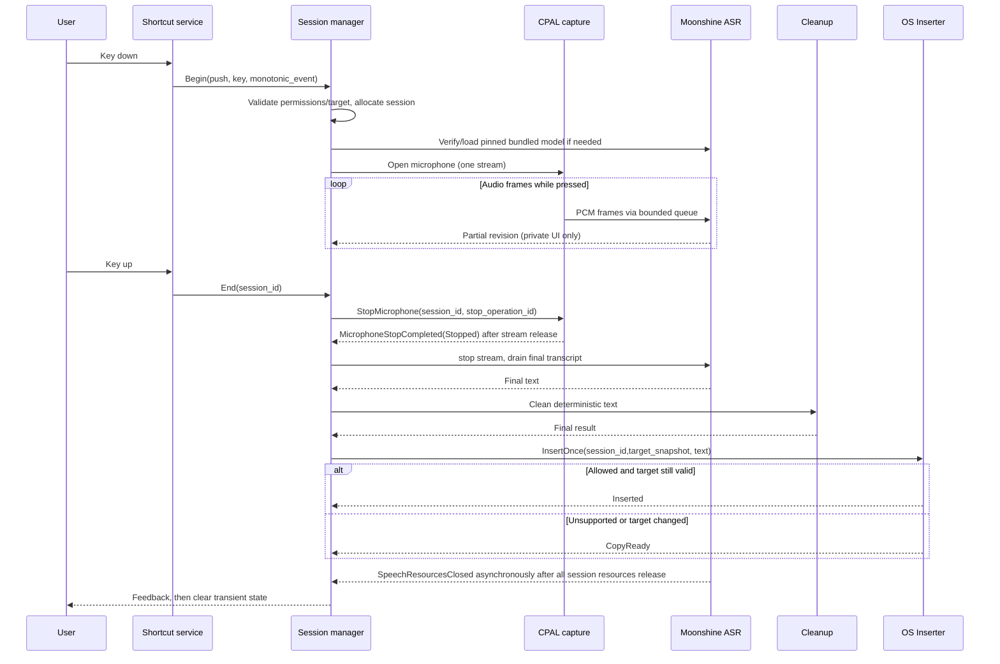
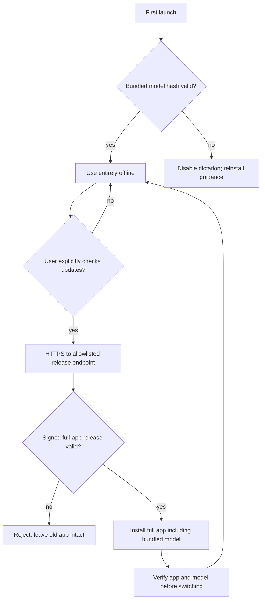
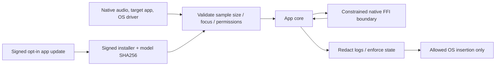

# ARCHITECTURE.md — Rust Desktop Dictation System Design

> **Status:** Architecture baseline with explicit feasibility gates · **2026-10-29**  
> **Canonical scope and gates:** [PRD.md](PRD.md) · **Dependencies and version policy:** [TECH_STACK.md](TECH_STACK.md) · **Flows:** [USER_FLOWS.md](USER_FLOWS.md) · **Build order:** [TASKS.md](TASKS.md)

## 0. Architecture invariants

- **A-INV-01 Local:** All audio processing and text cleanup are local. No model fetching, model selector, cloud inference, user login, transcript sync, telemetry, or unsolicited network traffic. The sole optional egress is a **user-invoked full-app signed update check**. Model weights arrive **with the installer and any signed app update**.
- **A-INV-02 Budget:** All app-owned processes **sum aggregate peak RSS <950,000,000 bytes** and installed footprint **<950,000,000 bytes**, measured as defined in [PRD §5.1](PRD.md#51-non-functional-requirements-nfr). The end user requested <1 GB, so 950 MB is the release threshold, **not a vendor-proven baseline**.
- **A-INV-03 No persistence:** No transcript database, audio recordings, dictated text cache, persistent application clipboard cache, remote analytics or transcript-bearing crash dumps. User-entered vocabulary/settings only.
- **A-INV-04 One active session:** At most one audio stream and one recognition stream exist. Every session has unique ID, immutable target snapshot, cancel token and explicit terminal disposition. Only a final result can be committed.
- **A-INV-05 Privilege boundaries:** Native adapters must respect OS permissions; refuse protected inputs and deny ambiguous targets. Unsupported Wayland uses user-invoked Copy fallback.
- **A-INV-06 Platform containment:** `app-core`/`audio`/`speech`/`text` know no platform implementation details. Platform services implement a strict interface and report capabilities. Nothing in UI owns a direct FFI handle.
- **A-INV-07 Determinism:** The MVP cleanup pipeline never invokes an LLM. No unreviewed silent semantic rewriting.
- **A-INV-08 Offline first:** All critical flows execute with DNS and network disabled from clean install.

## 1. Context and deployment



**OS services trusted but not controlled:** permission brokers, desktop compositor, accessibility API, microphone drivers, WebView runtime, clipboard service, code signature verifier. They can introduce failure modes the application must handle. **Not supported:** injection into elevated controls, protected/password fields, certain sandboxed apps, compositor-denied Wayland sessions.

### 1.1 Deployment choices

**MVP:** single Tauri OS process with Rust worker thread for ASR **unless** native-library isolation is needed based on P0 crash testing. This minimizes IPC, disk and duplication of runtime memory on 4 GB machines. `speech-runtime` is an abstraction with a versioned protocol so a future optional **child process** can be adopted. Child-process separation increases RSS and must clear the same 950 MB cap; do not add it purely for conceptual neatness. Native FFI is wrapped in a small audited module with no direct UI exposure.

**UI:** On startup, initialize application core + tray; create settings webview on demand and **destroy** on close. A lightweight state indicator may use the tray and OS notifications; avoid overlay windows at rest. If a webview helper stays alive after close, treat as resource regression.

**Packaging:** Bundle pinned `moonshine` native runtime, one quantized streaming English model directory, `model-manifest.json`, notices, compiled assets, Tauri shell. Never invoke Moonshine model manifest download functions from application runtime. The build pipeline may use vendor model download scripts in CI, pin the artifacts, verify SHA-256 and check licensing before packaging.

## 2. Logical components and relationships



## 3. Component responsibilities

| ID | Responsibilities and owning crate | PRD features | Technology decision | Verification |
|---|---|---|---|---|
| C-01 | Tauri tray, window lifecycle, onboarding/UI, accessibility and no-webview-in-idle | F-01,F-02,F-11,F-12,F-13 | TS-01 | AC-01,AC-02,AC-11 |
| C-02 | Event-driven session state machine, key binding/release, focus snapshot, cancellation, idempotency | F-03,F-04,F-13 | TS-02,TS-07 | AC-03,AC-04,AC-13 |
| C-03 | CPAL capture, stream lifecycle, format conversion and resampler | F-03,F-04,F-05 | TS-03 | AC-05 |
| C-04 | Preallocated ring, buffering, silence/no-speech detection, overflow strategy | F-05 | TS-04 | AC-05 |
| C-05 | Moonshine C ABI, streaming partial/final, quantized inference, version and thread budget | F-06,F-14 | TS-05 | AC-06,AC-14 |
| C-06 | Deterministic normalization, Unicode 18.0.0 canonical-caseless vocabulary keys, filler policy, keyterm mapping, V1 app profiles | F-07,F-08,F-15 | TS-06 | AC-07,AC-08,AC-15 |
| C-07 | OS permissions, capability checks, focus validation, text insertion, safe Copy fallback | F-02,F-09,F-10,F-15 | TS-07 | AC-02,AC-09,AC-10 |
| C-08 | Atomic settings and vocabulary persistence, migration, export/delete | F-08,F-11,F-12,F-15 | TS-08 | AC-08,AC-11,AC-12 |
| C-09 | Read-only model manifest verification, checksum, load/unload and packaging | F-01,F-06,F-13,F-14 | TS-05,TS-09 | AC-01,AC-06,AC-13 |
| C-10 | Content-free diagnostic events, perf profiles and optional signed whole-app update | F-13,F-12 | TS-10 | AC-12,AC-13 |

See [TECH_STACK §2](TECH_STACK.md#2-authoritative-technology-decisions) for library choices; [TASKS §4](TASKS.md#4-atomic-dependency-ordered-backlog) maps all IDs to implementation tasks.

### 3.1 Crate boundaries

- `core`: owns `Session`, `AppState`, `Action`, transitions; pure Rust, no Tauri.
- `audio`: CPAL input only, sample conversion, bounded producer, resampler thread; not allowed to access UI or filesystem while capturing.
- `speech-api`: `SpeechBackend` trait, model metadata types, structured error types, partial/final event contract.
- `speech-moonshine`: unsafe FFI facade; validates handles, pointer lengths, ownership, encoded bytes and native error codes.
- `text`: pure deterministic transforms with corpus/golden tests.
- `platform-api`: `GlobalShortcut`, `FocusResolver`, `TextInserter`, `PermissionService` traits; no direct frontend access.
- `platform-{macos,windows,linux}`: OS-specific implementations with capability probes and restricted APIs.
- `settings`: versioned JSON settings and vocabulary; no SQLite required for MVP (less size / complexity). SQLite candidate for V1 if relational use cases grow.
- `coordinator`: one reducer and event sequencer; routes typed effects through the queue-only speech and target contracts and narrow private-preview/result-panel/explicit-Copy ports; calls the existing settings cleanup pipeline with a cloned immutable session snapshot. It contains no native implementation.
- `shell`: Tauri integration, event broadcaster, allowlisted commands, tray, dialog, settings webview lifecycle.
- `release`: installer manifests, signature verification, update orchestration, non-content diagnostic exporter.

## 4. Runtime state machine

```mermaid
stateDiagram-v2
  [*] --> Uninitialized
  Uninitialized --> Idle: check packaged model and permissions
  Uninitialized --> Faulted: model absent/corrupt
  Idle --> Loading: accepted shortcut activation
  Loading --> Listening: model and microphone ready
  Loading --> Faulted: preparation / permission / microphone failure
  Loading --> Cancelled: cancel or release before capture starts
  Loading --> Finalizing: released while microphone start pending and input captured
  Listening --> Finalizing: key up / second toggle activation after capture
  Listening --> Cancelled: cancel, input loss, overflow, or release before capture
  Finalizing --> Cancelled: cancel before target commit
  Finalizing --> Committing: cleaned final and fresh target match; issue InsertOnce
  Finalizing --> CopyReady: changed / secure / unsupported target
  Finalizing --> Idle: silence
  Committing --> Idle: inserted once
  Committing --> CopyReady: definite failure, no side effect
  Committing --> Uncertain: possible partial insertion
  Uncertain --> CopyReady: manual review acknowledged; never auto-retry
  CopyReady --> Cancelled: explicit cancel clears result
  CopyReady --> Idle: dismissal or explicit copy succeeds
  Cancelled --> Idle: dismissal clears session
  Faulted --> Idle: failure dismissed; preparation requested on next start
```

**Key invariants:**

1. Every transition includes a checked, process-wide monotonic `SessionId` and strictly increasing `event_seq` to reject stale or duplicate events. Session IDs are in-process callback handles, not durable identifiers.
2. A push-to-talk release during model preparation cancels before microphone start. If release races an outstanding microphone start, the adapter receives a stop fence; the reducer finalizes only when input capture was acknowledged, otherwise it cancels and clears the session.
3. `Listening` alone owns an open microphone. `Cancelled` and `Faulted` always close input stream.
4. `Finalizing` is non-cancellable with respect to already emitted target insertion? Before `Committing`, cancellation may discard. After commit starts, consider outcome `uncertain`; never retry without user instruction.
5. Target editor is only mutated inside `Committing`; partial transcription only affects private UI preview.
6. `CopyReady` stores final text in RAM until Copy/Dismiss, never writes a transcript-history row.

### 4.1 Session data shape

```rust
// Conceptual types; exact platform handles are opaque and non-serializable.
struct Session {
    id: SessionId,
    kind: RecordingKind, // PushToTalk | Toggle
    state: SessionState,
    target: TargetSnapshot,       // bounded, non-content metadata
    started_at: MonotonicInstant,
    cancel: CancellationToken,
    partial_revision: u64,
    insert_attempted: bool,
}

struct TargetSnapshot {
    application_id: Option<String>,
    process_id: Option<u32>,
    window_token: Option<OpaqueWindowToken>,
    control_token: Option<OpaqueControlToken>,
    is_secure: bool,
    captured_generation: u64,
}
```

The Rust reducer uses a checked, process-wide monotonic ID for callback correlation; it is not a durable identifier. Any diagnostic use must remain content-free. `TargetSnapshot` cannot be persisted, uploaded, or used to scan document contents.

## 5. End-to-end data flows

### 5.1 Push-to-talk happy path (UF-03/UF-05/UF-07)



**Callback discipline:** Microphone callback must do O(frame) sample copy into bounded queue and return; cannot call `moonshine_transcribe_stream` in audio callback. ASR worker consumes, appends audio, asks for transcript approximately every 250–500 ms based on load. The Moonshine API's default caching window is ~200 ms; final stop forces drain. An external VAD may improve empty-input gating but should not be inserted until measured.

The reducer keeps its existing `StopMicrophone` then `FinalizeRecognition` effect order. The coordinator submits Stop, holds Finalize, and submits it only after the matching `MicrophoneStopCompleted(Stopped)` callback confirms capture callbacks have ceased and the microphone stream has been released. Queue acceptance alone never opens this barrier. Cancellation, device loss, overflow, or stop failure discards the pending finalization. A missing stop acknowledgment may remain unresolved without a timer; do not infer success from elapsed time.

Capture-stop acknowledgment and full speech-resource closure are separate facts. `SpeechResourcesClosed(session_id)` is still required after finalization or cancellation to confirm ASR/session resources are released and permit a later session. Stop callbacks carry both the session ID and checked stop-operation ID; stale, duplicate, and mismatched callbacks cannot satisfy another operation.

### 5.2 Toggle happy path

Same as push except `Begin(toggle)` at first activation and `End(session_id)` at second activation. Key-up during toggle is ignored. Conflicting push/toggle activations while active show `AlreadyRecording` with no parallel audio stream.

### 5.3 No-speech, error and focus mismatch

- **No speech:** stop -> drain -> trim -> empty -> `Idle`; no commit; short audible/visual no-speech notice subject to reduced motion.
- **Mic disconnect:** audio error -> `Cancelled` -> close input -> release ASR session -> show device recovery action; no insertion.
- **Target changed:** verify exact target identity at commit; if mismatch, never send keyboard events to current focus; show in-memory `CopyReady`.
- **Unsupported target:** show CopyReady and explanation; password/secure field is blocked even if user wishes to override direct insertion.
- **Partial native insertion:** record `Uncertain`, prohibit automatic retry/undo (unknown selection semantics); offer text copy for manual review.

### 5.4 Offline/updates flow



No application-startup update request, anonymous ping, model manifest fetch, or default remote configuration. The updater is isolated from dictation and does not receive transcript or vocabulary content.

## 6. API and IPC contracts

The main backend interfaces should compile and run in unit tests without Tauri or OS dependencies.

```rust
trait SpeechBackend: Send {
    fn verify_manifest(&self, expected: &BundledModelManifest) -> Result<()>;
    fn load(&mut self, path: &Path) -> Result<()>;
    fn begin(&mut self, sample_rate_hz: u32) -> Result<SpeechStreamId>;
    fn append_pcm(&mut self, id: SpeechStreamId, mono: &[f32]) -> Result<()>;
    fn poll(&mut self, id: SpeechStreamId) -> Result<TranscriptRevision>;
    fn finish(&mut self, id: SpeechStreamId) -> Result<FinalTranscript>;
    fn cancel(&mut self, id: SpeechStreamId) -> Result<()>;
    fn unload(&mut self) -> Result<()>;
}

trait TargetService {
    fn capability(&self) -> InsertionCapability;
    fn capture_target(&self) -> Result<TargetSnapshot>;
    fn insert_once(&self, id: SessionId, target: &TargetSnapshot,
                   finalized_text: &str) -> Result<InsertionResult>;
}
```

**Opaque handle lifecycle:** For Moonshine C ABI, call `moonshine_load_transcriber_from_files`, `moonshine_create_stream`, `moonshine_start_stream`, `moonshine_transcribe_add_audio_to_stream`, `moonshine_transcribe_stream`, `moonshine_stop_stream`, drain final transcript, `moonshine_free_stream`, then `moonshine_free_transcriber` on unload. Use the header `MOONSHINE_HEADER_VERSION` of the pinned checkout; validate at runtime via the available library version function. Do not copy the example's nonstreaming architecture constant when loading a streaming model. [Official C API](https://moonshine-voice.readthedocs.io/en/stable/api/c-api/).

**Moonshine ownership:** Each returned native transcript/buffer has C ownership semantics: wrapper must invoke the corresponding API release function, and never hold native data beyond its valid lifetime. Convert to owned Rust `String` after bounds checking. No unsafe calls from UI or capture callback.

### Asynchronous adapter acknowledgment contracts

`SpeechBackend::submit(StopMicrophone)` reports only whether the request entered the bounded adapter queue. The adapter later returns the correlated stop-completion callback after capture has stopped and the stream is released. Finalization remains pending until that callback succeeds. Stop failure follows content-free cancellation/failure handling, and later full-resource closure is acknowledged independently. If closure is never confirmed, the coordinator blocks another session.

`TargetService::submit(InsertOnce)` classifies submission failure as either **DefinitelyNotDispatched** or **OutcomeUnknown**. DefinitelyNotDispatched guarantees that no native mutation was attempted and yields CopyReady. OutcomeUnknown means a native API may have seen the request or partially changed the target and yields Uncertain with manual review required; it never retries or offers Copy before review. A successful submit means only that work was accepted and still needs an insertion-completion callback. Completion must be Inserted, a definite no-side-effect failure, or UncertainOrPartial. Adapters classify uncertainty conservatively: a failed OS call is not proof that no text was inserted.

### 6.1 Tauri command surface (internal only)

| Command | Input | Return | Rules |
|---|---|---|---|
| `get_status` | none | `AppStatus` | No transcript values in status |
| `get_permissions` | none | `PermissionMap` | Read-only |
| `request_permission` | `kind` enum | `PermissionStatus` | User-initiated, native OS prompt |
| `set_shortcut` | validated shortcut object | `ShortcutResult` | Detect collision before save |
| `list_audio_inputs` | none | `InputDeviceView[]` | Device IDs opaque, no host identifiers in logs |
| `set_audio_input` | `device_key` | `Result` | Atomic validation |
| `get_settings` | none | `SettingsDto` | Excludes private target snapshot |
| `update_settings` | versioned patch | `SettingsDto` | Whitelist fields; atomic write |
| `list_vocabulary` | none | `VocabularyEntry[]` | Local explicit vocabulary only |
| `upsert_vocabulary` | validated entry | `Result` | Length bounds, conflicts rejected |
| `delete_vocabulary` | UUID | `Result` | Idempotent |
| `begin_toggle` / `stop_toggle` | none | `SessionStatus` | Does not expose raw audio |
| `cancel_session` | session ID | `Result` | Never retries insertion |
| `copy_pending_result` | session ID | `CopyOutcome` | Explicit user action only |
| `dismiss_pending_result` | session ID | `Result` | Zeroize transient owned buffer best-effort |
| `export_diagnostics` | explicit file destination | `Result` | No audio/transcript/vocabulary values |
| `check_full_app_update` | none | `UpdateStatus` | Explicit only, valid signing |

**Frontend events:** `app:status`, `audio:level` (quantized scalar, throttled), `session:partial` (private preview only; ephemeral), `session:final_state`, `error:public`. Event payload schemas validated; no generic `eval`, raw `fs`, `shell` or open URL permission from remote content. Restrict Tauri capability config to required commands and local static frontend origin. Preserve CSP with no broad `unsafe-eval`.

### 6.2 Error types

```text
APP-001 MODEL_MISSING       => reinstall, never download
APP-002 MODEL_CHECKSUM      => reinstall, no inference
PERM-001 MIC_DENIED         => permissions onboarding
PERM-002 INJECTION_DENIED   => copy fallback
HOTKEY-001 REGISTER_FAILED  => alternate shortcut
AUDIO-001 DEVICE_LOST       => select device/retry
AUDIO-002 BUFFER_OVERFLOW   => session cancelled; non-content diagnostic
ASR-001 MODEL_OOM          => unload; stop; error (never cloud)
ASR-002 NATIVE_FAILURE     => safe abort; optional worker restart
TEXT-001 NO_SPEECH         => no insertion
INSERT-001 TARGET_CHANGED  => copy fallback
INSERT-002 SECURE_CONTROL  => refuse direct insertion
INSERT-003 UNSUPPORTED     => copy fallback
INSERT-004 UNCERTAIN       => manual review, no retry
UPDATE-001 INVALID_SIG     => reject package, old stays installed
```

## 7. Persisted data models

**No transcript tables.** MVP store as versioned JSON in user config directory, written atomically with temp file + flush + fsync/rename according to platform semantics, restrictive owner permissions. The app may use `serde_json`; SQLite is not required.

```json
{
  "schema_version": 1,
  "language": "en",
  "recording": {
    "push_to_talk": "Ctrl+Alt+Space",
    "toggle": "Ctrl+Alt+D",
    "input_device": "system-default"
  },
  "cleanup": {"mode": "clean", "remove_fillers": true},
  "startup": {"run_at_login": false},
  "updates": {"user_initiated_only": true},
  "vocabulary": [
    {"id":"example-id", "spoken":"north parkade", "written":"North Parkade"}
  ]
}
```

Shortcuts above are **example serialization only**, not universal defaults: actual defaults must avoid conflicts and be registered on each OS; use platform-specific defaults at first launch. `language` remains `en` for MVP; no model UI. Validate `schema_version` and migrate unknown versions safely. Store app license/attribution notices as read-only shipped files.

The `outflow-settings` library also exposes a small explicit-path service: missing files yield validated in-memory defaults without a write; supported preference and vocabulary changes are applied to a candidate snapshot and committed through the atomic writer before replacing live state. Vocabulary operations reuse the stable-ID CRUD functions and the Unicode 18 core validator. Schema v1 contains no matching-policy provenance, so every nonempty collection loaded from disk is reported as `Unknown` and requires an explicit review acknowledgment in that service instance before writes. The acknowledgment is not persisted or inferred from a schema version or marker; opening again requires review again. A conflict-only review decode preserves original strings and order for manual repair while the ordinary loader remains strict. The service changes the stored run-at-login preference only; OS registration remains a shell/platform responsibility. Windows owner-only ACL persistence remains unimplemented.

The current schema-v1 decoder also requires vocabulary IDs to be unique. A duplicate stable ID is ambiguous for ID-based edits, so both strict loading and the read-only vocabulary-review path return a content-free error with the two entry indices; they do not rewrite the original file. The review path still preserves spoken-phrase conflicts for explicit repair when IDs are unique. Each `SettingsService` instance holds its own in-memory snapshot. If two instances write from stale snapshots, atomic replacement prevents a torn file but the last replacement wins and may discard the other instance's update. Callers currently own serialization; the service adds no file locking or watcher.

The platform-independent Rust reducer lives in `outflow-core::session_engine` as reusable C-02 logic. `outflow-coordinator` owns the reducer and event sequencer, routes effects in reducer order, and invokes the existing deterministic settings cleanup pipeline using a cloned immutable cleanup/vocabulary snapshot for each accepted session. A process-wide checked atomic counter supplies monotonic, nonzero session IDs shared across reducer instances; each reducer accepts the coordinator's strictly increasing event sequence. IDs are in-process coordination handles, not durable IDs or transcript log keys. Typed events and effects describe future work; the queue-only `SpeechBackend` and `TargetService` traits have no OS implementation here. A bounded `TargetSnapshot` contains opaque target identity, generation, security and editability only, never document text. `InsertOnce` means exactly one adapter attempt and still requires fresh target revalidation immediately before mutation. If its side-effect status is uncertain, the adapter must report `UncertainOrPartial`; the reducer requires manual review before CopyReady. CopyReady retains final text only in volatile memory. Each explicit Copy request receives a checked, session-scoped attempt ID; duplicate pending clicks emit no second Copy effect, and completions must match the outstanding attempt. Dismissal/cancellation invalidates old acknowledgments. Speech Stop is routed before Finalize or Cancel, and coordinator cleanup remains `UNRESOLVED` until the matching speech-resource closure acknowledgment arrives; a failed queue request never claims that resources were released. This boundary does not implement microphone capture, Moonshine, native shortcuts, Tauri, OS text insertion, or a clipboard.

**Bundled model manifest** (generated in CI, signed by signed installer; hashes validated at app launch):

```json
{
  "format_version": 1,
  "model_id": "moonshine-small-streaming-en-quantized",
  "upstream_git_commit": "REPLACE_WITH_VERIFIED_40_HEX_COMMIT",
  "source_model_revision": "REPLACE_WITH_PINNED_ARTIFACT_REVISION",
  "model_architecture": "small-streaming",
  "license": "MIT",
  "files": [
    {"path": "encoder.ort", "sha256": "REPLACE_WITH_REAL_SHA256", "bytes": 0}
  ]
}
```

**Important:** The manifest is an illustrative schema, NOT real hash values or a complete file list. Production CI must derive file entries from the selected pinned Moonshine version and reject placeholder values. Moonshine's actual quantized streaming files typically include frontend/encoder/decoder/tokenizer/config assets; copy **all** required files from the official version-locked manifest, never assume one `.ort` file is sufficient. This manifest is checked against actual installation byte accounting.

## 8. Performance budget and benchmark method

All numbers below are **engineering budgets for future tests**, not measurements. They intentionally sum below user-requested 1 GB.

| Phase | Proposed aggregate RSS ceiling (decimal MB) | Notes |
|---|---:|---|
| Tray idle; settings closed; model unloaded | 100 | No open mic or webview |
| Settings open; no recording | 250 | Webview included |
| Model warm, no recording | 650 | Model weights/runtime included |
| Active streaming (including indicator) | **850 target**, **950 hard release gate** | Full process tree, CPU-only 4 GB |
| Finalizing + insertion / copy panel | 950 hard | Include peak temporary allocations |

**Disk allocation plan**, target total <950 decimal MB: signed binaries, native dependency runtime, one bundled ASR model and all tokenizer assets, static UI, support files, notices and migrations. Use actual artifact sizes in release reports: estimated values are insufficient. No second parallel model/LLM/discrete language pack in MVP.

### 8.1 Benchmark protocol

1. Collect baseline with `network=deny`, capture disabled, UI closed, and release build; wait 10 minutes for stable idle metric.
2. Measure aggregate RSS **every 100 ms** across entire app-owned process tree from process start through 10 minutes active dictation and forced finalization. Capture 10 repetitions and use global observed maximum across runs. On Linux use `/proc/<pid>/status` `VmRSS` / `smaps_rollup` PSS, on Windows `GetProcessMemoryInfo` Working Set and PrivateUsage, macOS `task_info` resident/physical footprint. Clearly label incomparable semantics.
3. Sum app-owned helper processes, avoid counting OS-shared services not attributable to the app; also report PSS/private footprint to understand shared mappings.
4. Measure installed footprint by recursively summing unpacked installed files after actual installer run, without counting OS frameworks already installed. Count duplicated model files and update residues left in app directory.
5. Measure ASR real-time factor `ASR wall time / utterance duration` per file. Record median/p95 and end-to-final/insertion latency; cold and warm paths separately.
6. Freeze a multilingual/accented English reference set with exact human transcriptions, punctuation policy, and split by quiet/noisy; compute WER on normalized tokens, show raw WER and punctuation separately. Do not compare against vendor WER from different corpora.
7. Power A/B: identical 4 GB laptops or controlled sequential runs on battery with screen/network/load held constant; idle tray vs no-app baseline, active session vs baseline microphone; publish methodology not just percentage.
8. Gate on worst-case observed test results and hardware thermal state; re-run with settings webview open concurrently and during worker fault/recovery.

**Performance fallback order:** remove unnecessary webviews; cap inference threads; use model quantized graph and memory mapping; shorten context/keep-alive; tune audio chunks; disable optional VAD; only then consider Tiny model, conditioned on quality. Never optimize by sending audio to cloud or hiding processes from accounting.

## 9. Platform adapters

### macOS

Check `AXIsProcessTrustedWithOptions` and `NSMicrophoneUsageDescription`. On start capture frontmost app/window/control identity using Accessibility APIs; after dictation validate target before using supported AX mutation or Quartz/keyboard events. AX selected-text mutation is conditional on target capabilities and editable state, not guaranteed. If denied, use CopyReady. Code signing/notarization required for commercial distribution; direct Developer ID install preferred over Mac App Store given sandbox conflicts. [Apple AX](https://developer.apple.com/documentation/applicationservices/1459186-axisprocesstrustedwithoptions); [mic usage description](https://developer.apple.com/documentation/BundleResources/Information-Property-List/NSMicrophoneUsageDescription).

### Windows

Use `windows` crate, keyboard registration or native hotkey hook carefully, UI Automation as a **capability probe** (not universal caret insertion), `SendInput` UTF-16 Unicode events where permitted. UIPI prevents lower integrity apps injecting into elevated targets. No UiAccess privilege shortcuts or bypass. Handle surrogate pairs, IME and shortcut press/release identity. [Microsoft SendInput](https://learn.microsoft.com/windows/win32/api/winuser/nf-winuser-sendinput).

### Linux X11

Detect `DISPLAY` and X11 session, use XTest or X11 injection only in supported editable controls. Expect window-manager differences; include dedicated X11 integration tests. Tray support also varies; ensure keyboard/menu fallback if system tray cannot appear.

### Linux Wayland

Detect `XDG_SESSION_TYPE=wayland`, portal availability and compositor. Prefer `GlobalShortcuts` portal with Activated+Deactivated events for hold-to-talk if supported. `RemoteDesktop` portal may offer keyboard injection with explicit user approval and libei/EIS; do **not** assume availability or persistent permission. If global shortcut missing, user opens tray/menu toggle; if insertion missing, use CopyReady panel. Never rely on elevated `ydotool`, fake kernel uinput access or compositor hacks. [GlobalShortcuts](https://flatpak.github.io/xdg-desktop-portal/docs/doc-org.freedesktop.portal.GlobalShortcuts.html); [RemoteDesktop](https://flatpak.github.io/xdg-desktop-portal/docs/doc-org.freedesktop.portal.RemoteDesktop.html).

## 10. Security and trust boundaries



- **Tauri permissions:** capability-based allowlist of exact commands; disable broad file/process/shell APIs from webview. CSP, local-only scheme, no remote scripts, no eval, strict input validation.
- **FFI:** vendor-version-specific bindings, panic/exception isolation, ownership checks, maximum chunk lengths, no pointer crossing threads without API guarantee; fuzz parsers and hostile/malformed model files.
- **Model supply chain:** pinned upstream commit + exact model revision + SHA-256 per asset, transitive legal notices, static linkage evaluation, reproducible packaging.
- **Updates:** operator signs installers and update artifacts; update checks only after explicit click, encrypted HTTPS, release host allowlist, signature verified before installation, full bundled model replaced atomically where OS permits. Keep rollback path; do not expose signing keys to build logs.
- **Sensitive data:** no logs, telemetry, remote errors, history, text-bearing diagnostics, or nonessential target text inspection. Explicit clipboard copy may be observed by other system software.
- **OS restrictions:** Do not request admin/root or attempt to bypass protected controls. Disallow UI-driven arbitrary shell/file access.
- **Legal:** data minimization and local computation do not independently establish GDPR/PIPEDA or industry compliance; track applicable jurisdictional duties and consumer disclosures before release.

## 11. Scalability, maintainability, and fault containment

This is a **single-user local process**, not a multi-tenant backend; scalability means many sessions/day, long recordings, device churn and OS updates. No cloud autoscaling, Redis, message broker or distributed DB. The architecture intentionally favors bounded local memory over parallel speech streams. For future features, `SpeechBackend`, `PlatformTarget`, `SettingsRepository` are replaceable behind interfaces; version migrations in a pure Rust package. Native library crash may bring down process in MVP; test first, optionally isolate ASR worker if risk justifies memory cost. On restart, never resume uncertain text insertion automatically.

## 12. Verification and rollout

- **Phase 0 blockers:** physical 4 GB machine benchmarks (model Small/Tiny), OS shortcut release semantics, macOS focus safety, Windows UIPI, Linux Wayland permission/fallback, license provenance.
- **CI:** formatting, clippy, Rust tests, golden audio/text corpus, contract tests, dependency audits, `cargo deny`, license manifest, native binary signatures, offline clean-install smoke, memory and disk release gates.
- **Cross-OS test:** macOS Apple Silicon and Intel (if supported), Windows 10/11 x64, X11 Linux x64; Wayland GNOME/KDE capability matrix. Publish minimum OS and architecture only after test certification.
- **Go/no-go:** do not promise compliance with 4 GB/<1 GB without real measured builds; move release date, reduce scope or seek explicit change of requirements instead.

## 13. Source links

- [Tauri 2 architecture and capability permissions](https://v2.tauri.app/learn/security/using-plugin-permissions/)
- [Moonshine versioned C API including streaming drain](https://moonshine-voice.readthedocs.io/en/stable/api/c-api/)
- [Moonshine quantized model layouts](https://moonshine-voice.readthedocs.io/en/stable/models/quantization/)
- [CPAL audio backend and runtime support](https://docs.rs/crate/cpal/latest)
- [Microsoft SendInput and UIPI](https://learn.microsoft.com/windows/win32/api/winuser/nf-winuser-sendinput)
- [Apple Accessibility trust](https://developer.apple.com/documentation/applicationservices/1459186-axisprocesstrustedwithoptions)
- [XDG GlobalShortcuts portal](https://flatpak.github.io/xdg-desktop-portal/docs/doc-org.freedesktop.portal.GlobalShortcuts.html)
- [XDG RemoteDesktop portal](https://flatpak.github.io/xdg-desktop-portal/docs/doc-org.freedesktop.portal.RemoteDesktop.html)
- [Tauri updater signing](https://v2.tauri.app/plugin/updater/)
- [NIST secure software development framework](https://csrc.nist.gov/pubs/sp/800/218/final)
