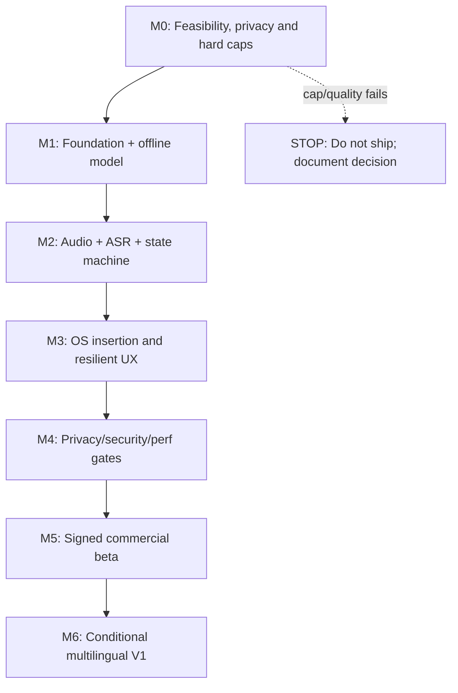
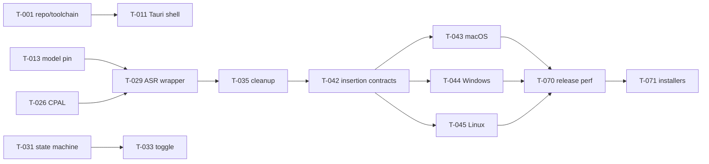

# TASKS.md — Dependency-Ordered Engineering Backlog

> **Status:** In progress; checkboxes remain open until evidence is accepted · **Revision:** 1.2 · **2026-11-03**
> **Product authority:** [PRD.md](PRD.md) · **Architecture:** [ARCHITECTURE.md](ARCHITECTURE.md) · **Technology:** [TECH_STACK.md](TECH_STACK.md) · **Behavior:** [USER_FLOWS.md](USER_FLOWS.md)

## 0. How agents should use this checklist

**Do not declare a task complete merely because code was written.** To check it, implementation must exist, a focused test must pass, an integration check must be recorded where relevant, and the requested artifact/evidence must be committed. Use one PR per small coherent batch (ideally 1–3 adjacent tasks), preserve ID references and leave unchecked items unchanged until verified.

- Task `T-xxx` is stable and immutable. If split, append subtask suffix like `T-026a`; do not renumber all task IDs.
- Dependencies (`Deps`) reference must-complete tasks unless explicitly marked `parallel`. A hard gate cannot be skipped without changing the PRD.
- Every task's `F-xx`, `C-xx`, `UF-xx`, and `AC-xx` point to exact definitions in companion files. Where appropriate, the milestone section supplies shared cross references.
- **No customer runtime model downloads. No model chooser. No cloud. No transcript history. No LLM in MVP.** Any proposed change that violates these constraints requires formal scope change before code.
- **Peak RSS+disk <950,000,000 bytes**, **4 GB physical RAM CPU-only** are release gates. Do not claim compliance from published vendor model parameters alone.
- An explicit `MODEL_DECISION.md` may be generated as **build evidence**, but the requested user-facing deliverables remain exactly these five documents.

### 0.1 Recommended agent workflow

1. Read all five files, then resolve the next earliest unchecked task whose dependencies are all done.
2. Inspect current repository and source docs; record assumptions in PR. Implement minimal change scoped to task.
3. Add or update unit/integration test and run formatter, linter, focused tests and relevant platform smoke.
4. Inspect diff and resource impact. For OS/FFI work run target-native tests; a mock alone is insufficient for hardware certification.
5. Write evidence to `evidence/T-xxx.md` with command, date/OS, expected vs observed, links to logs (redacted), and issue IDs.
6. Only then mark `[x]` in this file; never mark complete via a speculative code suggestion.

### 0.2 Prompt 79 execution note — partial native inference evidence

Prompt 79 verified a local-only Small Streaming model bundle by observed SHA-256, built the pinned Moonshine C API as an arm64 macOS dylib, confirmed exported stream lifecycle symbols, and ran two real fixture-backed C API streaming sessions with nonempty partial and final transcripts. The reproducible smoke harness and detailed record are `tests/native/moonshine_streaming_smoke.cpp`, `evidence/mvp/prompt-79-model-assets.json`, and `evidence/mvp/prompt-79-macos-dictation.md`. This evidence does **not** complete the app vertical slice: no Tauri shell, Rust binding, microphone capture, session state machine, cleanup integration, target validation, insertion, Copy Result, or offline app launch exists. No task checkbox is changed by this note.

Prompt 79C added a reusable 100 ms macOS/Linux process-tree RSS sampler, a privacy-preserving native ASR evaluator/result validator, stronger fixture and asset integrity checks, and build-scope/license evidence. The pinned Small model's eight local file hashes still validate (142,300,974 bytes), while its immutable artifact revision and redistribution approval remain unknown. The existing native smoke was rebuilt and again produced nonempty partial/final results in two sessions. Ten process-tree RSS runs reached 1,023,426,560 bytes; four exceeded the 950,000,000-byte threshold. This is the current native harness/library tree, not the complete Outflow app. The measured evaluator cannot run WER because the fixture manifest has zero ready references. The 18 GB M3 Pro is not the required physical 4 GB target. Accessibility trust is not granted, so no insertion controls were tested. The native library still includes optional TTS and diarization code; TTS-off failed at compile/link without changing pinned source. T-002, T-003, T-004, T-006, T-009, and T-010 remain incomplete. See `evidence/mvp/prompt-79c-detailed-implementation-handoff.md`, `evidence/model/MODEL_DECISION.md`, and `evidence/mvp/prompt-79c-native-license-audit.md` for exact results and remaining blockers.

Prompt 79D corrected the corpus coverage, physical 4 GB eligibility, actual macOS dyld identity, and measured-results pre-write validation. Ready fixtures now need independent duration and diversity attributes; 100 short + 50 long alone cannot pass. The evaluator requires exact physical bytes and an approved reference class; the allowlist is empty, and the 18 GB M3 Pro is ineligible. A standalone verifier confirmed the exact helper, Moonshine, and ONNX Runtime image identities for one arm64 development build. The native benchmark remains fail-closed at 0 ready fixtures, so there is no WER result. The paired 20-run memory matrix found default-thread RSS peaks up to 1,010,614,272 bytes; the upstream TSan/reliability-only single-thread switch peaked at 907,902,976 bytes but increased p95 session latency about 2.69× and is not adopted for production. Small remains `BLOCKED — INSUFFICIENT EVIDENCE`; Tiny is a source-inspected fallback only, not acquired or tested. The full test/evidence handoff is `evidence/mvp/prompt-79d-detailed-implementation-handoff.md` and `evidence/mvp/prompt-79d-native-memory-measurements.json`. T-002, T-003, T-004, T-006, T-009, and T-010 remain incomplete.

Prompt 79E adds an isolated development-only macOS AppKit/AVFoundation probe. Three real microphone permission/capture sessions completed: two produced nonempty partial and final results, while one captured 47.8 seconds without recognition. A device run exposed tap callbacks larger than the original audio block, so capture now splits callback frames into bounded queue blocks and has a targeted test. Ten real-time-paced fixture worker runs and two visible app fixture sessions also completed; one 30-second app-window RSS trace peaked at 919,814,144 bytes on this 18 GB host. These results are prototype evidence only; no human-reviewed reference or WER exists. Exact metadata from the third spoken session was saved without transcript or audio content. No production task checkbox changed: T-011, T-025–T-034, AC-06, and T-010 remain incomplete/blocked. The PRD's “4 GB” does not specify decimal versus binary bytes; classification now allows up to exactly 4,294,967,296 bytes for screening, while owner clarification, independently verified physical hardware, and the approved reference-class allowlist remain required. See `evidence/mvp/prompt-79e-detailed-implementation-handoff.md` and `evidence/mvp/prompt-79e-timed-fixture-measurements.json`.

Prompt 79F hardens cancellation in that isolated probe without changing the pinned Moonshine API or model. The permission completion now requires the same live request generation, session ID, Preparing state, open window, and a fresh AVFoundation Authorized check. Cancel invalidates permission, stops AVAudioEngine/fixture production before worker cancellation/join, clears queue samples and volatile preview/final fields, and rejects stale worker events; Dismiss joins terminal cleanup before returning to Idle. Native tests inject synchronization at model load, queue feed and final drain and run 100 worker plus state restart cycles; app source-contract tests cover the asynchronous permission and callback guards. The physical AppKit session verified live partial→Cancel clearing/release, Dismiss→new live session→Stop/final, and an early live Cancel. This remains prototype evidence only and does not complete any production task or release gate. Detailed sanitized outcomes and exact commands are in `evidence/mvp/prompt-79f-detailed-implementation-handoff.md`.

Prompt 79G adds a native AppKit Copy Result button to that development probe. A pure policy binds nonempty final text to the accepted ResultReady session; an injectable writer is called once only from the mouse/Return action, and lifecycle cleanup clears the volatile result. The fixture UI showed the button enabled after a recognized final result and disabled for a silent result; Return reached the guarded action. Automated policy/privacy checks pass, including unchanged Unicode/multiline pass-through, stale-session rejection and no lifecycle writes. A disposable synthetic sentinel appeared unchanged in one earlier no-click/failed-write check, but the final manual-selection/⌘C follow-up did not paste the expected fixture result; its blank TextEdit target received unexpected pre-existing clipboard content, so manual paste remains **not verified**. That unsaved target was discarded without saving, and the clipboard was not inspected further, cleared, or restored. NSPasteboard returned failure for the button action in this host. The source and fake-writer tests establish that no write is invoked during recognition or lifecycle handling, but successful button copy, a reliable final sentinel check, and manual paste are **not verified**. The test used the existing authorized model and fixture and changed no ASR/model/source ABI. This evidence is development-only: do not mark T-046, T-047, T-010, T-011, AC-10, or the MVP complete. See `evidence/mvp/prompt-79g-detailed-implementation-handoff.md` for exact validation and the remaining clipboard, microphone, and production blockers.

### React vocabulary list preview — development evidence (2026-11-04)

The browser-only Settings → Text & Vocabulary form now adds validated spoken/written pairs to a React-memory list of up to 500 entries and allows individual removal. Entries survive Settings-section and Home/Settings navigation, then reset on a full page reload or fresh `App` mount. The accessible count, empty state, field validation, Unicode display, draft clearing, and disabled full-list action are covered by frontend tests. Browser verification at `http://localhost:5173/` confirmed empty-input validation, adding a Unicode pair, removing it, and the empty state. This is development evidence only: no persistent vocabulary CRUD, native settings integration, or speech replacement was added. Production **T-038 remains unchecked**; this note does not satisfy F-08, AC-08, T-038, T-039, or T-053.

Environment: macOS Darwin 25.6.0 arm64, Node.js v22.23.3, npm 10.9.9. Commands/results: `npm ci` — PASS; `npm run dev` — PASS, Vite 8.3.5 served `http://localhost:5173/`; `npm run typecheck` — PASS; `npm run test -- --run` — PASS, 11 files and 148 tests; `npm run lint` — PASS; `npm run build` — PASS, Vite built 29 modules; `git diff --check` — PASS.

### Vocabulary entry editing — development-preview extension (2026-11-04)

The browser-only list now also supports editing one existing entry at a time. Save updates its spoken and written values in place while preserving its ID and list order; Cancel keeps the original entry. Both fields use the preview form's existing nonempty, whitespace, 128-Unicode-scalar, and malformed-surrogate validation. The edit form has labeled fields and linked descriptions/errors, blocks edits to other rows until Save or Cancel, focuses Spoken phrase on open, returns focus to Edit on exit, and supports native keyboard actions. Saved values remain in React memory across Settings/Home navigation and reset after a fresh `App` mount. The automated suite covers Save, Cancel, stable row identity/order, invalid values in both fields, Unicode/emoji, keyboard/focus, navigation, Add/Remove, and the 500-entry limit.

Browser verification: `npm run dev` — PASS; Vite 8.3.5 served `http://localhost:5174/` because port 5173 was occupied. In the browser, I opened Settings → Text & Vocabulary, added `café 東京 😀` → `Café 東京 ✨`, edited and saved it as `naïve 文 📍` → `Naïve 文 🧭`, then changed a second edit draft and canceled. The saved pair remained visible, the row count stayed at 1 of 500, and focus returned to its Edit button. This remains development-preview evidence only; no data is persisted or applied to speech. Production **T-038 remains unchecked** and this does not satisfy F-08, AC-08, T-038, T-039, or T-053.

Environment: macOS Darwin 25.6.0 arm64, Node.js v22.23.3, npm 10.9.9. Commands/results: `npm run typecheck` — PASS; `npm run test -- --run` — PASS, 11 files and 160 tests; `npm run lint` — PASS; `npm run build` — PASS, Vite built 29 modules (CSS 16.33 kB, JavaScript 247.07 kB); `git diff --check` — PASS. The edit-list test file also passed independently: 22/22. The Impeccable detector returned no findings for the changed interface files.

### Native Rust vocabulary CRUD — partial T-038 evidence (2026-11-04)

`outflow-settings` now exposes in-memory Add/Edit/Delete functions for stable-ID vocabulary entries. Candidate collections reuse `outflow-core::vocabulary::validate_vocabulary_collection`, including the 500-entry cap, 128-Unicode-scalar fields, and Unicode 18 canonical-caseless duplicate checks. Rejections are typed, content-free, and leave the original vector unchanged. Edit retains ID and position; Delete uses a unique stable ID. Fourteen focused tests cover these behaviors and redacted errors. The synthetic `vocabulary_crud` example also demonstrated Add → Edit → isolated temporary-file save/reload through the existing atomic writer → Delete.

This is a partial implementation only. CRUD does not persist production settings, migrate settings, connect React to Rust, implement boundary-aware correction, or change schema-v1 validation and matching. The save/reload line is an example of existing settings APIs and uses a fresh temporary directory; it does not add persistence to CRUD. **T-038 remains unchecked** because its complete requirements and T-017/T-018 prerequisites are not met. T-017, T-018, T-039, AC-08, and every release gate also remain open. Exact commands, output, platform limits, and results are in [`evidence/rust-vocabulary-crud-task-38.md`](../evidence/rust-vocabulary-crud-task-38.md).

The implementation and example are in `crates/settings/src/vocabulary_crud.rs` and `crates/settings/examples/vocabulary_crud.rs`. Final Rust verification passed: formatting check, workspace check, all 367 workspace tests, Clippy with warnings denied, and workspace build. Frontend verification passed with typecheck, 160 tests across 11 files, lint, and production build; no frontend source changed. The current macOS inventory is documented as an 18 GB development machine, not the required physical 4 GB release reference. No app performance or release metric was measured.

### Native Rust vocabulary post-correction — partial T-039 evidence (2026-11-04)

`outflow-core::vocabulary_post_correction::apply_vocabulary_post_correction` now validates one spoken/written mapping with the existing vocabulary validator, then replaces complete case-insensitive phrase occurrences using the existing Unicode 18 canonical-caseless comparison key. It preserves replacement spelling exactly and copies all unmatched input bytes unchanged. Matching stays inside the pure Rust core and requires no added dependency, browser, Moonshine, settings, filesystem, or network access. Sixteen focused unit tests cover phrase and repeated replacement, punctuation and whitespace, larger-word rejection, contractions, accented and canonically equivalent text, combining-mark boundaries (including the `cafe` + combining-accent regression), non-ASCII letters, emoji, invalid mappings, input immutability, and determinism. A synthetic example demonstrates correction while retaining decomposed-accent text, Japanese text, and emoji.

This is one building block only. It does not implement multiple-entry precedence, keyterm hints, the complete cleanup pipeline, or settings/ASR integration. **T-039 remains unchecked** because its listed prerequisites and full requirements are not met. T-035, T-038, T-039, AC-07, AC-08, and all release gates remain incomplete. Exact evidence is in [`evidence/T-039-native-vocabulary-post-correction.md`](../evidence/T-039-native-vocabulary-post-correction.md).

On macOS 26.6.2 arm64 with Rust 1.99.1, the requested example, format check, workspace check, all 384 workspace tests (including doctests), Clippy with warnings denied, workspace build, and `git diff --check` passed. No frontend source or dependency changed, so frontend checks were not rerun. Performance, recognition, and release metrics were not measured.

### Native Rust multi-entry vocabulary post-correction — partial T-039 evidence (2026-11-04)

`outflow-core::vocabulary_post_correction::apply_vocabulary_post_corrections` now validates a complete zero-to-500-entry collection before scanning the original text. It reuses Unicode 18 D145 canonical-caseless comparison and the existing conservative word-boundary policy. The scanner advances left to right, selects the longest valid original span at each start, and uses entry order as the stable tie-break. It skips overlaps, never scans inserted replacement text, copies each written value exactly, and preserves unmatched bytes. Seventeen focused tests cover empty/one/multiple mappings, repetition, multiword and overlapping phrases, longest precedence, non-cascading output, Unicode folding/canonical equivalence, combining-mark protection, unrelated Unicode, duplicate and invalid entries, the 500-entry limit, redacted errors, input immutability, and repeatability. The synthetic three-mapping example checks the requested output and separately demonstrates a non-cascading replacement.

This is a partial T-039 building block only. It does not add Moonshine keyterm hints, punctuation/filler cleanup, persistent settings, or ASR/frontend integration. **T-035, T-038, T-039, AC-07, AC-08, and all release gates remain unchecked.** Exact verification commands and observed example output are recorded in [`evidence/T-039-multi-entry-vocabulary-post-correction.md`](../evidence/T-039-multi-entry-vocabulary-post-correction.md).

### Native Rust whitespace normalization — partial T-035 evidence (2026-11-04)

`outflow_core::text_cleanup::normalize_transcript_whitespace` is a standalone pure Rust stage for canonicalizing CRLF/CR line endings and horizontal ASCII spacing. It preserves newlines, non-ASCII whitespace, and all other text. The synthetic example prints debug-formatted input/output and asserts both its exact expected string and idempotence. Thirty-two table fixtures check output, input immutability, and idempotence; four additional focused tests cover newline count/placement, ASCII-only trimming, Unicode and punctuation preservation, and empty text. No dependency or frontend/native integration changed.

This is only a partial T-035 building block: punctuation cleanup, dictation commands, vocabulary ordering/integration, and the full golden corpus remain out of scope. T-023 is still unchecked, so this result does not complete the dependent production T-035. **T-035, T-036, T-038, T-039, AC-07, AC-08, and all release gates remain unchecked.** Exact evidence is in [`evidence/T-035-whitespace-normalization.md`](../evidence/T-035-whitespace-normalization.md).

### Native Rust text cleanup composition — partial T-035/T-039 evidence (2026-11-04)

`outflow-core::text_cleanup::normalize_whitespace_and_apply_vocabulary` composes the existing transcript whitespace normalizer with the existing collection vocabulary post-corrector. Whitespace normalization runs first; the validated collection then uses the existing Unicode 18 canonical-caseless matcher, conservative boundaries, and longest-match precedence. Replacement text is copied exactly and is not scanned again in the same call. The function does not normalize replacement output again. Its rustdoc and a focused test explicitly show that this single-call non-cascading property does not guarantee idempotence when the complete pipeline is run repeatedly.

Sixteen focused unit tests cover empty input and vocabulary, normalization before single- and multiword correction, multiple entries, CRLF and standalone carriage returns, paragraph breaks, punctuation/numbers, composed and decomposed accents, emoji/Japanese text, longest-match precedence, non-cascading behavior, exact replacement spacing/newlines, invalid and duplicate mappings, the 500-entry limit, input/entry immutability, deterministic repeated calls, and the repeated-application limitation. The synthetic `text_cleanup_composition` example prints debug-formatted input/output and compares its result and unrelated Unicode against exact expected strings.

This remains a partial development slice. At the time of this earlier composition, dictation-command recognition was not yet implemented; the following entry records that subsequent stage. Punctuation/capitalization cleanup, Clean/Verbatim filler policy, Moonshine keyterm hints, persistence, and ASR/frontend integration remain out of scope. T-023 and the prerequisites for full T-035/T-039 are unresolved. **T-023, T-035, T-036, T-038, T-039, AC-07, AC-08, and every release gate remain unchecked.** Exact commands and observed results for this earlier slice are recorded in [`evidence/T-035-T-039-text-cleanup-composition.md`](../evidence/T-035-T-039-text-cleanup-composition.md).

### Native Rust opt-in dictation commands — partial T-035 evidence (2026-11-04)

`outflow_core::text_cleanup::apply_dictation_commands` adds deterministic, opt-in recognition for the exact ASCII phrases `new line` and `new paragraph`. The new `normalize_whitespace_commands_and_apply_vocabulary` composition follows FR-07.3 order: normalize source whitespace, optionally convert commands, then apply validated vocabulary corrections. Recognized commands take precedence over vocabulary matches. Vocabulary output is copied exactly and is not normalized afterward. The existing `normalize_whitespace_and_apply_vocabulary` API preserves its behavior by delegating with command recognition disabled.

The focused command fixtures cover disabled handling; start/middle/end positions; both break types; ASCII case variants; repeated and consecutive commands; separator trimming; normalized tabs and CRLF; existing line/paragraph breaks; word boundaries; quotes/punctuation; incomplete phrases; Unicode and emoji; and deterministic input preservation. Composition coverage includes command precedence, correction after commands, longest-match and non-cascading vocabulary behavior, typed validation errors, unchanged input/entries, and repeatability. A synthetic example asserts the exact enabled and disabled outputs with debug-formatted output.

On macOS Darwin 25.6.0 arm64 with Rust 1.99.1, the example, formatting check, workspace check, workspace tests/doctests, Clippy with warnings denied, workspace build, and `git diff --check` all passed after formatting was applied. The example printed enabled output `"I use Rust\nat UBC\n\nNorth Parkade"` and disabled output `"I use Rust new line at UBC new paragraph North Parkade"`. The 37 command fixtures and seven additional command-composition tests passed as part of the workspace suite. No dependency or lockfile changed; memory, latency, and release gates were not measured.

This is a partial T-035 building block only. Exact command and workspace validation results, observed example output, environment, and remaining limitations are recorded in [`evidence/T-035-dictation-commands.md`](../evidence/T-035-dictation-commands.md). T-023 remains unmet, and punctuation/capitalization cleanup, Clean/Verbatim filler policy, full golden-corpus acceptance, and application integration remain open. **T-023, T-035, T-036, T-038, T-039, AC-07, AC-08, and all release gates remain unchecked.**

### Native Rust punctuation spacing — partial T-035 evidence (2026-11-04)

`outflow_core::text_cleanup::normalize_punctuation_spacing` is a standalone deterministic stage that removes ASCII spaces/tabs before the six supported punctuation marks only when the prior non-whitespace character is alphabetic, the mark is followed by whitespace or input end, and the adjacent alphanumeric token contains no numeric character. It preserves ambiguous punctuation/quote sequences, punctuation marks, words, numbers, Unicode, emoji, and line breaks. It does not insert punctuation, add post-punctuation spacing, or implement complete punctuation restoration. The stage is not integrated into the existing whitespace/command/vocabulary composition.

The exact-output table has 62 fixtures covering all six marks, already-correct text, repeated spaces/tabs, multiple edits, numeric/date/version protection, abbreviations and ellipses, quoted/ambiguous punctuation, line and paragraph breaks, Unicode letters and combining marks, Japanese, emoji, untouched whitespace, idempotence, deterministic calls, and original-input preservation. The synthetic example asserts the requested four-line output and idempotence.

At the time this standalone stage was recorded, punctuation spacing was not yet ordered after vocabulary correction. The following integration entry adds that ordering while preserving the original standalone API. This remains a partial T-035 building block; **T-023, T-035, T-036, T-038, T-039, AC-07, AC-08, and all release gates remain unchecked.** Exact standalone commands and results are recorded in [`evidence/T-035-punctuation-spacing.md`](../evidence/T-035-punctuation-spacing.md).

### Native Rust protected vocabulary replacement spans — partial T-035/T-039 evidence (2026-11-04)

The multi-entry vocabulary corrector now has `apply_vocabulary_post_corrections_with_spans`, which returns corrected text and ordered UTF-8 byte ranges for the exact written replacements inserted into it. Ranges are captured during the existing output-building pass, so validation, Unicode 18 matching and boundaries, longest-match precedence, non-overlap, and non-cascading behavior remain shared with the text-only API. Focused tests cover empty and unmatched cases, repeated and multiple replacements, multiword and longest matches, non-cascading behavior, byte offsets across multibyte and combining text, exact replacement whitespace/punctuation/newlines, collection validation and duplicate handling, immutability, determinism, and text-only parity. A synthetic runnable example asserts the exact corrected output, ranges, and replacement slices.

This prepared formatting to preserve written replacement text; the following integration entry uses those ranges without changing the existing punctuation rules. The exact example output, commands, results, and limitations are recorded in [`evidence/T-035-T-039-protected-vocabulary-spans.md`](../evidence/T-035-T-039-protected-vocabulary-spans.md). **T-023, T-035, T-036, T-038, T-039, AC-07, AC-08, and all release gates remain unchecked.**

### Native protected-aware punctuation after vocabulary — partial T-035/T-039 evidence (2026-11-05)

`outflow_core::text_cleanup::normalize_whitespace_commands_vocabulary_and_punctuation` now composes whitespace normalization, opt-in dictation commands, multi-entry vocabulary correction with UTF-8 provenance ranges, and the existing conservative punctuation-spacing rule in that order. The punctuation implementation is shared with the standalone API. It retains any candidate whitespace run that intersects a protected replacement, preserves written replacement bytes exactly, and still corrects eligible spacing outside a replacement. Internal updated ranges are used only for provenance verification and are not returned by the public API after offsets shift.

Focused exact-output coverage includes empty inputs/collections, the requested replacement and Unicode examples, multiple and repeated replacements, protected leading/trailing/internal whitespace and punctuation, partially intersecting candidate runs, eligible punctuation after a replacement, emoji/accented/combining text, newlines and paragraph breaks, numeric/version and abbreviation/ambiguous-punctuation protection, enabled/disabled command ordering, longest-match precedence, non-cascading corrections, invalid/duplicate collections, immutability, determinism, and unchanged behavior of existing public APIs. Repeated whole-pipeline calls can still cascade vocabulary mappings; this limitation is documented and tested.

This is one integration slice only, not completion of production T-035 or T-039. T-023 prerequisites, the full cleanup corpus and filler/capitalization work, Moonshine hints, persistent vocabulary integration, ASR/frontend integration, and release gates remain outstanding. **T-023, T-035, T-036, T-038, T-039, AC-07, AC-08, and every release gate remain unchecked.** Exact environment, commands, results, example output, and remaining gaps are in [`evidence/T-035-T-039-protected-punctuation-integration.md`](../evidence/T-035-T-039-protected-punctuation-integration.md).

### Native line-leading filler removal — partial T-036 evidence (2026-11-05)

`outflow_core::text_cleanup::remove_leading_isolated_fillers(input, enabled)` is a standalone Clean/Verbatim stage. Enabled calls remove only ASCII case-insensitive `um, ` or `uh, ` at the beginning of a line when the following character is alphabetic. Disabled calls preserve the input. The implementation keeps repeated supported filler sequences, indentation, quoted/punctuation-adjacent phrases, numbers, sentence-internal/final fillers, and unrelated UTF-8 bytes unchanged; it preserves existing LF, CRLF, and CR line endings. Its normalized-input assumption and exact one-ASCII-space matching rule are documented.

Fifty-five exact-output fixtures cover the requested filler, mode, capitalization, position, incomplete phrase, repeated sequence, punctuation, number, abbreviation, proper-noun, whitespace, newline, Unicode, emoji, immutability, determinism, and idempotence cases. The synthetic example prints the input and Clean/Verbatim outputs with Rust debug formatting and asserts both exact outputs, idempotence, and unchanged input. No dependency, persisted settings schema, or composed cleanup API changed.

This entry records the original standalone implementation. At that point, filler removal was not integrated after punctuation spacing, had no settings adapter, and did not use protected vocabulary ranges. The remaining T-035/T-017 prerequisites, broader cleanup policy, complete acceptance corpus, application integration, and release gates remain outstanding. **T-023, T-035, T-036, T-038, T-039, AC-07, AC-08, and every release gate remain unchecked.** Exact commands, results, environment, commit, and limitations for that earlier slice are in [`evidence/T-036-leading-filler-removal.md`](../evidence/T-036-leading-filler-removal.md).

### Native protected-aware filler integration — partial T-036 evidence (2026-11-05)

`outflow_core::text_cleanup::process_transcript_with_optional_fillers(input, entries, commands_enabled, fillers_enabled)` composes the five current FR-07.3 cleanup stages: whitespace normalization, optional dictation commands, vocabulary post-correction, protected punctuation spacing, and optional filler removal. The standalone `remove_leading_isolated_fillers` API remains available and uses the same conservative `um, ` / `uh, ` recognizer. Filler deletion runs only when its explicit flag is enabled; this argument does not select or persist the complete Clean/Verbatim policy.

The protected-aware filler stage deletes a candidate only when no part of its `um, ` or `uh, ` prefix intersects a vocabulary replacement range. It retains the entire candidate on overlap, while allowing a separate unprotected line-leading filler to be removed. Replacement ranges are adjusted after deletions and remain private. Exact-output tests cover the requested protected-replacement cases, Unicode and multiple offset shifts, command/vocabulary order, punctuation order, errors, deterministic behavior, and compatibility of existing APIs. No dependency, settings schema, or unrelated untracked content changed.

The runnable example prints `Input: "um, rust , at ubc ."`, `Fillers enabled: "Rust , Edition, at UBC."`, `Fillers disabled: "um, Rust , Edition, at UBC."`, and `Protected replacement preserved: true`; it asserts both complete outputs and the protected filler-like replacement. Workspace validation and actual output are recorded in [`evidence/T-036-protected-filler-integration.md`](../evidence/T-036-protected-filler-integration.md).

This remains a partial T-036 slice. T-035/T-017 prerequisites, the full 50-case T-036 goldens, acceptance corpus, ASR/application integration, platform testing, and all release gates remain open. **T-017, T-018, T-023, T-035, T-036, T-038, T-039, AC-07, AC-08, and every release gate remain unchecked.**

### Native cleanup preference adapter — partial T-036 evidence (2026-11-05)

`outflow_settings::cleanup_policy::process_transcript_with_filler_preference` maps the existing settings to the core filler flag using exactly `mode == Clean && remove_fillers`. The adapter changes only filler deletion; all four mode/flag combinations still pass through the existing whitespace, optional command, vocabulary, punctuation, and protected-filler stages. It adds no settings fields, migrations, dependencies, or runtime/application integration.

Fifteen focused `cleanup_policy` tests pass, including all four combinations, default settings, command/vocabulary independence, exact protected-replacement bytes, Unicode and paragraph breaks, typed invalid/duplicate errors, immutability, determinism, and settings JSON round-trip. The new runnable example asserts all four complete outputs and the protected `um, keep this` replacement. Workspace tests pass (191 core unit tests, 128 settings unit tests, all integration suites, and all 11 doctests); format, check, Clippy, and build also pass. Exact commands, observed output, environment, and remaining gaps are in [`evidence/T-036-cleanup-preference-adapter.md`](../evidence/T-036-cleanup-preference-adapter.md).

This is only a partial T-036 building block. **T-017, T-018, T-023, T-035, T-036, T-038, T-039, AC-07, AC-08, and every release gate remain unchecked.**

### Clean/Verbatim mode contract characterization — partial T-036 evidence (2026-11-05)

Added `docs/CLEANUP_MODE_POLICY.md` to separate confirmed FR-07 requirements and current behavior from unresolved Verbatim semantics. It presents three alternatives and a recommendation explicitly marked **PROPOSED — NOT APPROVED**; the PRD and production APIs are unchanged. The new `cleanup_mode_contract` example prints and asserts all four mode/filler combinations for the synthetic `um, rust new line at ubc .` input. It also shows that disabling commands preserves literal `new line` while vocabulary and punctuation stages still run. Nine integration tests lock the public adapter contract across modes, Unicode and paragraph cases, protected replacements, errors, immutability, determinism, and schema-v1 JSON.

This remains a characterization only. The three policy questions—formatting stages in Verbatim, vocabulary correction in Verbatim, and behavior of explicitly enabled dictation commands—still require a maintainer decision before complete Verbatim semantics are implemented. No production cleanup behavior, settings fields, defaults, or serialization changed. **T-017, T-018, T-023, T-035, T-036, T-038, T-039, AC-07, AC-08, and all release gates remain unchecked.** Exact verification commands, observed output, and results are recorded in [`evidence/T-036-cleanup-mode-contract.md`](../evidence/T-036-cleanup-mode-contract.md).

### Cleanup golden corpus foundation — partial T-035/T-036 progress (2026-11-05)

Added `crates/settings/tests/fixtures/cleanup_current_behavior.json` with 24 independently specified synthetic current-behavior cases and a data-driven integration test in `crates/settings/tests/cleanup_golden_corpus.rs`. The cases cover all eight fixture categories, the four Clean/Verbatim and filler-setting combinations, both command-flag values, exact output, determinism, and input/vocabulary/settings immutability. The runner rejects missing or unknown fields and reports fixture-level failures with the fixture ID and category. Its printed “current behavior baseline” summary is characterization only; it does not approve a final Verbatim policy.

This is a small reusable harness foundation, not completion of T-035 or T-036. The corpus is not the required ≥200-case AC-07 acceptance corpus and does not establish its ≥99% exact-output threshold, complete protected-token checks, quality results, production integration, or release gates. No production cleanup behavior, settings schema, defaults, or dependencies changed. **T-017, T-018, T-023, T-035, T-036, T-038, T-039, AC-07, AC-08, and every release gate remain unchecked.** Exact commands, results, environment, and limitations are in [`evidence/T-035-T-036-cleanup-golden-foundation.md`](../evidence/T-035-T-036-cleanup-golden-foundation.md).

### Cleanup preservation fixture expansion — partial T-035/T-036 progress (2026-11-05)

Expanded the synthetic current-behavior corpus from 24 to 48 explicit fixtures, adding six cases each for numeric preservation, proper nouns/abbreviations, Unicode preservation, and protected vocabulary interactions. The runner now requires exactly 48 fixtures and retains the existing schema, category/mode/flag coverage, exact-output, determinism, and immutability checks. No production cleanup behavior, settings schema, defaults, dependencies, or Verbatim policy changed.

The focused corpus test passes all 48 cases. One source-confirmed current behavior is recorded: punctuation spacing after the year `2026` remains as `2026 .` because the existing rule trims only when the preceding character is alphabetic and the adjacent alphanumeric token contains no number. This is a characterization, not an approved cleanup-policy change. The 48 fixtures do not satisfy AC-07's ≥200-case corpus or prove universal numeric/proper-noun protection. **T-017, T-018, T-023, T-035, T-036, T-038, T-039, AC-07, AC-08, and all release gates remain unchecked.** Verification commands, results, and remaining limitations are recorded in [`evidence/T-035-T-036-cleanup-safety-fixtures.md`](../evidence/T-035-T-036-cleanup-safety-fixtures.md).

### Cleanup interaction fixture expansion — partial T-035/T-036 progress (2026-11-05)

Expanded the current-behavior baseline from 48 to 72 independently specified synthetic fixtures. The 24 additions are grouped into six dictation-command boundary/case cases; six filler and mode interactions; six vocabulary precedence, Unicode 18 boundary, repetition, and non-cascading cases; and six punctuation/protected-replacement cases. The runner now requires exactly 72 and retains its eight-field schema, all eight categories, four mode/filler-setting combinations, both command flags, exact output, repeatability, and input/vocabulary/settings immutability checks. The expected values were reviewed from the existing Rust source and policy before running the focused test. No production cleanup/settings behavior, schema, defaults, dependency, or Verbatim policy changed.

The 72-fixture corpus and nine-test cleanup-mode contract pass. Formatting, workspace check/tests, Clippy with warnings denied, workspace build, and both diff whitespace checks also pass on the current macOS arm64 development host. The year-spacing case remains `2026 .` under the existing numeric guard. A written replacement with one leading and one trailing space remains exact; its trailing protected space combines with the separately normalized source separator, producing two spaces before the following source word. This records existing byte-preservation behavior, not a policy change. The corpus remains below AC-07's ≥200 cases and does not establish its ≥99% exact-output threshold, exhaustive numeric/proper-noun protection, production integration, or release gates. **T-017, T-018, T-023, T-035, T-036, T-038, T-039, AC-07, AC-08, and all release gates remain unchecked.** Exact fixture IDs, commands, environment, outputs, and limitations are in [`evidence/T-035-T-036-cleanup-interaction-fixtures.md`](../evidence/T-035-T-036-cleanup-interaction-fixtures.md).

### Protected-token golden assertions — partial T-035/T-036 progress (2026-11-05)

Added optional test-only `protected_tokens` metadata to the existing 72-fixture cleanup baseline. Sixteen manually reviewed UTF-8 byte-range annotations cover eight numeric values and eight proper nouns across 12 fixtures. The checker compares exact declared bytes in input, independently specified expected output, and actual cleanup output; it rejects invalid bounds, UTF-8 splits, overlap/duplicates, wrong token values, and changed output. Five synthetic negative cases exercise these rejection paths. The fixture count and eight-field required schema are unchanged; no production cleanup, settings model, persisted schema, vocabulary behavior, or dependencies changed.

This is test infrastructure only. It does not provide universal preservation guarantees or complete T-035/T-036 or AC-07. The 72 cases remain below AC-07's ≥200-case requirement and do not establish its ≥99% exact-output threshold, production integration, or final acceptance. The Verbatim recommendation remains **PROPOSED — NOT APPROVED**. **T-017, T-018, T-023, T-035, T-036, T-038, T-039, AC-07, AC-08, and all release gates remain unchecked.** Exact annotated tokens, commands, environment, results, branch, and limitations are recorded in [`evidence/T-035-T-036-protected-token-golden-checks.md`](../evidence/T-035-T-036-protected-token-golden-checks.md).

### Cleanup multiline, mode-boundary, and Unicode fixture expansion — partial T-035/T-036 progress (2026-11-05)

Expanded the current-behavior characterization corpus from 72 to 96 by appending 24 explicitly reviewed synthetic cases in four groups: multiline whitespace/commands; punctuation and numeric boundaries; Clean/Verbatim filler boundaries; and Unicode/protected vocabulary interactions. The original 72 fixture objects remain unchanged, including the 16 numeric/proper-noun annotations across 12 fixtures. The existing five synthetic negative protection checks, strict UTF-8 range checks, exact-byte validation, and eight-plus-eight annotation-count assertions are retained. No production cleanup behavior, settings schema/defaults, dependency, or Verbatim policy changed.

The focused 96-fixture test and Clean/Verbatim contract test characterize current behavior only. Notable cases preserve every normalized line break, including the additional breaks around a `new paragraph` command; punctuation spacing after `2026` remains `2026 .`; and canonical-equivalent vocabulary matching replaces only the full configured spoken span while preserving unmatched source text. The corpus remains below AC-07's ≥200-case requirement and does not establish its ≥99% exact-output threshold, universal numeric/proper-noun protection, production integration, or release readiness. **T-017, T-018, T-023, T-035, T-036, T-038, T-039, AC-07, AC-08, and all release gates remain unchecked.** Exact fixture IDs, the base-object comparison method, commands, environment, results, and limitations are recorded in [`evidence/T-035-T-036-cleanup-96-fixtures.md`](../evidence/T-035-T-036-cleanup-96-fixtures.md).

### Cleanup boundary fixture expansion — partial T-035/T-036 progress (2026-11-05)

Expanded the current-behavior golden corpus from 96 to 120 by appending 24 explicitly authored synthetic fixtures in four groups: ASCII whitespace and line-ending boundaries; Clean/Verbatim and line-leading filler interactions; Unicode 18 vocabulary matching and boundaries; and punctuation with protected-token/replacement preservation. The runner requires exactly 120 cases and retains the existing schema, all eight category checks, all four Clean/Verbatim × filler-setting combinations, both command-flag values, exact expected output, deterministic repeat calls, input/vocabulary/settings immutability, strict protected-token metadata checks, and all five synthetic negative checks. A parsed-object comparison against base commit `6f4a31222a5b0f0fe40b529052491da1a0cac8c7` confirmed the first 96 objects and their 16 annotations are unchanged; the annotations remain eight numeric and eight proper-noun tokens across the same 12 fixtures. No production cleanup or settings behavior, schema, dependency, or policy changed.

The focused 120-fixture corpus passes. Its whitespace cases document that ASCII spaces/tabs are trimmed at each line edge and collapsed within lines, LF/CRLF/CR are represented as LF without changing break count, and non-ASCII whitespace is copied. Protected replacement whitespace remains exact; `2026 .` remains spaced under the existing numeric guard; command-generated line breaks and source line breaks compose without collapsing; and Verbatim continues to run the current non-filler pipeline while preserving fillers. The corpus remains below AC-07's ≥200-case requirement and does not establish its ≥99% exact-output threshold, universal numeric/proper-noun protection, production integration, or release readiness. The Clean/Verbatim proposal remains **PROPOSED — NOT APPROVED**. **T-017, T-018, T-023, T-035, T-036, T-038, T-039, AC-07, AC-08, and all release gates remain unchecked.** Exact fixture IDs, comparison method, commands, environment, outputs, findings, and limitations are recorded in [`evidence/T-035-T-036-cleanup-120-fixtures.md`](../evidence/T-035-T-036-cleanup-120-fixtures.md).

### Cleanup false-positive and boundary fixture expansion — partial T-035/T-036 progress (2026-11-05)

Expanded the current-behavior characterization corpus from 120 to 144 by appending 24 explicit synthetic fixtures in four ordered groups of six: whitespace preservation and boundaries; filler false-positive prevention; Unicode 18 vocabulary boundaries and precedence; and multi-stage safety interactions. The runner now requires exactly 144 fixtures and preserves its strict schema, eight categories, all four Clean/Verbatim × filler-setting combinations, both command settings, exact-output and repeatability assertions, input/vocabulary/settings immutability, protected-token UTF-8 byte checks, and five synthetic rejection cases. A one-off parsed-JSON comparison against base commit `815d00ebbfc4bcda50eeaddde4e2ab5ee202a9ee` confirmed that the first 120 fixture objects and all 16 existing annotations are unchanged; no new protected annotations were added.

The focused corpus passes all 144 cases with eight categories, eight protected numeric tokens, and eight protected proper nouns unchanged. The Clean/Verbatim contract test passes all nine cases; on macOS 26.6.2 arm64 with Rust 1.99.1, formatting, workspace check, all 500 workspace tests, Clippy with warnings denied, and workspace build also pass. Source review confirmed that a `new paragraph` command emits two line breaks while an immediately following source CRLF contributes a third after normalization; the long composition fixture therefore expects three breaks. No production cleanup behavior, settings schema/defaults, dependency, or policy changed. `docs/CLEANUP_MODE_POLICY.md` remains **PROPOSED — NOT APPROVED**. The corpus remains below AC-07's ≥200-case requirement and does not establish its ≥99% exact-output threshold, universal number/proper-noun preservation, production integration, or release readiness. **T-017, T-018, T-023, T-035, T-036, T-038, T-039, AC-07, AC-08, and every release gate remain unchecked.** Exact fixture IDs, comparison output, environment, all verification results, and limitations are in [`evidence/T-035-T-036-cleanup-144-fixtures.md`](../evidence/T-035-T-036-cleanup-144-fixtures.md).

### Cleanup ambiguous-boundary fixture expansion — partial T-035/T-036 progress (2026-11-05)

Expanded the synthetic current-behavior corpus from 144 to 168 by appending 24 explicitly specified fixtures in four ordered groups of six: ambiguous punctuation/quotation boundaries; Unicode matching/boundary safety; repeated vocabulary/precedence; and cross-stage cleanup/preservation. The runner's exact count and module documentation now require 168. A one-off parsed-JSON comparison against base commit `f0bf356147f3fe0d63990f1365403f54130a9caa` confirms that the first 144 fixture objects are identical, including all 16 original protected-token annotations across 12 fixtures (eight numeric and eight proper-noun tokens). No annotations were added to the new fixtures. IDs remain unique; all eight categories, all four mode/filler combinations, both command settings, and 24 unique new inputs are present. The existing five synthetic rejection cases and runner assertions remain intact.

The focused corpus prints all 168 fixtures passed, eight categories, eight protected numeric tokens unchanged, and eight protected proper nouns unchanged. The 24 new expected strings were written from review of the current Rust stage ordering, punctuation guard, Unicode 18 canonical-caseless boundaries, and replacement-span behavior; the focused test found no mismatches and no expectations required correction. No production cleanup/settings behavior, schema/defaults, dependencies, lockfiles, or policy changed. The new Unicode replacement case intentionally preserves `Crème  brûlée, v2 . 0` and leaves its adjacent `0 ,` spacing; numeric-adjacent spacing such as `2026 .` remains unchanged. The Clean/Verbatim recommendation remains **PROPOSED — NOT APPROVED**.

This is independently verifiable partial progress only. A 168-case characterization is still below AC-07's ≥200 acceptance cases and does not prove its ≥99% exact-output threshold, comprehensive numeric/proper-noun protection, final Clean/Verbatim distinction, or production integration. T-035 prerequisites, deterministic/idempotence requirements, T-036's remaining policy and acceptance work, and all platform/release gates remain open. **T-017, T-018, T-023, T-035, T-036, T-038, T-039, AC-07, AC-08, and all release gates remain unchecked.** Exact fixture IDs, comparison command/result, test output, environment, and remaining limitations are recorded in [`evidence/T-035-T-036-cleanup-168-fixtures.md`](../evidence/T-035-T-036-cleanup-168-fixtures.md).

### Cleanup numeric, Unicode whitespace, command, and protected-range fixture expansion — partial T-035/T-036 progress (2026-11-05)

Expanded the synthetic current-behavior corpus from 168 to 192 by appending 24 explicitly reviewed fixtures in four ordered groups of six: numeric/proper-noun safety; Unicode whitespace and text boundaries; command/filler edges; and protected vocabulary/stage-order safety. The runner now requires exactly 192 fixtures while retaining strict schema parsing, eight-category coverage, the four mode/filler combinations, both command settings, exact UTF-8 output, repeatability, input/vocabulary/settings immutability, protected-token byte/range checks, and all five synthetic rejection cases. A one-off parsed-JSON comparison against base commit `71be6c46888e6e1ec68373104567e652ba87222c` confirms that the first 168 objects are unchanged and ordered, including all 16 original annotations across 12 fixtures (eight numbers and eight proper nouns). Exactly 24 unannotated fixtures were appended; IDs and new inputs are unique. No production cleanup/settings behavior, schema/defaults, dependency, lockfile, or policy changed.

The focused 192-fixture test prints all cases passed, eight categories, eight protected numeric tokens unchanged, and eight protected proper nouns unchanged. Source review corrected two initially mistaken expectations: `6.02e23 !` retains its space because the preceding alphanumeric token contains digits, and consecutive `new line`, `new paragraph`, `new line` commands emit four additive line breaks. The Clean/Verbatim recommendation remains **PROPOSED — NOT APPROVED**. All requested focused, workspace, format, lint, and build checks pass on macOS 26.6.2 arm64 with Rust/Cargo 1.99.1; exact outputs and preservation assertions are in [`evidence/T-035-T-036-cleanup-192-fixtures.md`](../evidence/T-035-T-036-cleanup-192-fixtures.md).

This remains partial task evidence only. AC-07 still requires at least 200 acceptance fixtures (at least eight more than this characterization), ≥99% exact expected output, zero altered numeric/proper-noun tokens across its acceptance corpus, a demonstrated final Clean/Verbatim distinction, and production integration. This task does not complete T-035/T-036 or any release gate. **T-017, T-018, T-023, T-035, T-036, T-038, T-039, AC-07, AC-08, and all release gates remain unchecked.**

### Cleanup 200-fixture count milestone — partial T-035/T-036 progress (2026-11-05)

Expanded the current-behavior characterization from 192 to exactly 200 fixtures by appending one case in each existing category: `whitespace-multiline-leading-blank-lines-and-unicode-space`, `commands-paragraph-between-existing-lines-and-unicode-text`, `vocabulary-overlapping-phrases-with-protected-punctuation`, `punctuation-numeric-token-and-curly-quote-ambiguity`, `fillers-clean-mode-removes-prefix-in-paired-comparison`, `modes-verbatim-preserves-prefix-in-paired-comparison`, `unicode-combining-boundary-and-japanese-punctuation`, and `safety-multiline-protected-replacement-beside-number-and-name`. The paired Clean/Verbatim cases intentionally share the same input, vocabulary, filler setting, and command setting; the only duplicate new input is that pair.

The focused 200-fixture test passes with all eight categories, all four mode/filler combinations, both command settings, the original eight protected numeric and eight proper-noun annotations unchanged, and all existing strict schema, determinism, immutability, UTF-8 range, and five rejection assertions. A one-off `git show` plus Python `json.loads` comparison against base commit `ba1a7d1fb4491e628ac1950c19b78083aefa0735` confirms the original 192 parsed objects are unchanged and in order; exactly eight fixtures were appended. AC-07 acceptance is explicitly **NOT EVALUATED**: the 200 outputs characterize the current baseline only, and the approved final acceptance set and ≥99% exact-output threshold remain open. The existing 16 selected protected annotations are not a universal guarantee. The Clean/Verbatim policy remains **PROPOSED — NOT APPROVED**. No production cleanup/settings behavior, persisted schema/defaults, dependencies, or lockfiles changed.

This is a numerical corpus milestone only. T-035 prerequisites, idempotence, and production integration remain open; T-036 final semantics and integration remain open. **T-017, T-018, T-023, T-035, T-036, T-038, T-039, AC-07, AC-08, and all release gates remain unchecked.** Exact comparison output, test environment, commands, results, and AC-07 status are recorded in [`evidence/T-035-T-036-cleanup-200-fixture-milestone.md`](../evidence/T-035-T-036-cleanup-200-fixture-milestone.md).

### Independent AC-07 scoring utility — partial T-035/T-036 evaluation-tool progress (2026-11-05)

Added a standalone Python standard-library scorer for caller-supplied expected/actual strings and in-memory synthetic threshold tests. Exact equality does not normalize Unicode, punctuation, capitalization, or whitespace; the 200-case minimum and 99% threshold are reported separately, and the latter uses integer arithmetic. The `--demo` output explicitly marks protected-token acceptance and AC-07 acceptance **NOT EVALUATED** and the Clean/Verbatim policy **NOT APPROVED**. Added [`docs/AC07_EVALUATION_PLAN.md`](AC07_EVALUATION_PLAN.md) to distinguish numerical scoring from acceptance evidence.

This is evaluation infrastructure only. The existing 200 current-behavior fixtures are not automatically an independently approved acceptance oracle; protected-token evaluation, final mode semantics, and production integration evidence remain outstanding. The cleanup policy remains **PROPOSED — NOT APPROVED**. **T-017, T-018, T-023, T-035, T-036, T-038, T-039, AC-07, AC-08, and all release gates remain unchecked.** Exact commands, observed output, and limitations are recorded in [`evidence/T-035-T-036-ac07-scoring-foundation.md`](../evidence/T-035-T-036-ac07-scoring-foundation.md).

## 1. Milestone map / critical path



| Milestone | Dependencies | Exit evidence | Stop condition |
|---|---|---|---|
| M0 (P0) | None | Real Small/Tiny CPU-only WER, disk, process-tree RSS; OS integration matrix; license review | No bundled model meets simultaneous quality, 4 GB, <950 MB gates |
| M1 (P1) | M0 | Offline Tauri shell, pinned dependency graph, immutable bundled model manifest, build artifacts | Model not bundled; network needed to launch |
| M2 (P2) | M1 | 100 push/toggle cycles, stable ASR, 200 cleanup goldens, no silent audio leaks | Any data leaves computer; unbounded recording memory |
| M3 (P3) | M2 | Certified focus-safe insertion and fallback on supported OS targets; accessible UI | Wrong-target injection or secure-field violation |
| M4 (P4) | M3 | Audited native FFI, error recovery, memory/disk/battery verification, no telemetry | Performance or security gate fails |
| M5 (P5) | M4 | Signed/notarized verified installers; staged opt-in update; beta signoff | Unsigned updater, invalid licenses, lost rollback |
| M6 (V1) | M5 | Per-language quality AND aggregate hard caps, no model download | Combined languages exceed limits |

**Milestone estimates** for a small experienced team (not commitments): P0 1–2 weeks; P1 1–2; P2 2–3; P3 3–5; P4 2–4; P5 2–4; V1 only after research/fit.

## 2. Acceptance and test tools

Use Rust `cargo fmt`, `cargo clippy`, `cargo test`, plus MSVC/Apple Clang/GCC platform compilation, native ASan/UBSan for selected C/C++ builds, `cargo audit`, `cargo deny`, manifest hash verifier, JS `tsc --noEmit`, Vite build and WebView accessibility smoke. Each OS needs release-artifact packaging; a successful `cargo test` does not certify clipboard, permissions, keyboard hooks, code signing, memory, or installers.

**Proof paths (proposed):** `evidence/model/`, `evidence/perf/<os>-<hardware>/`, `evidence/security/`, `evidence/accessibility/`, `evidence/platform/<os>/`, `evidence/release/`, `tests/fixtures/`. No real customer audio in CI. Synthetic text only in screen recordings. A dedicated licensed audio fixture corpus may be locally accessible to CI, with distribution restrictions documented.

## 3. Dependency graph and platform work distribution



Parallel workers may edit separate crates behind a pinned trait interface after T-023/T-042. Do not simultaneously edit shared public traits or Cargo manifests without ownership; merge one change at a time, re-run `cargo check --workspace` and rerun all contract tests. Prefer separate Git worktrees/branches for simultaneous OS adapters.

## 4. Atomic dependency-ordered backlog

Each task includes the primary feature/acceptance link and concrete completion artifact. The list is dependency-ordered within milestones; platform-specific tasks may run in parallel after the interface is stable.

### M0 — Research, feasibility and security proof (no product release)

- [x] **T-001 — Initialize repository policies.** Deps: none. Create Rust workspace shell, contribution rules, `.editorconfig`, license/notice templates; pass formatting sanity. [F-01/C-01/AC-01]
- [ ] **T-002 — Confirm supported OS/CPU matrix.** Deps: T-001. List physical 4 GB target machines and exact OS/build; capture machine/CPU IDs with no personal data. [F-01/C-01/AC-01]
- [ ] **T-003 — Define benchmark fixture manifest.** Deps: T-001. Record audio corpus provenance, human references, normalization and 100+ speech phrases; version fixture hashes. [F-06/C-05/AC-06] Prompt 79D adds auditable duration and independent coverage attributes; only the 100-short/50-long counts plus quiet/noisy/accent-variety/names/technical/numbers/abbreviations/silence/provenance/human-review gates can report complete. The manifest still has 0 ready fixtures. Common Voice's current terms conflict with repository mirroring; LibriSpeech needs exact-file selection and human review. T-003 remains incomplete; see `docs/BENCHMARK_FIXTURES.md` and the Prompt 79D handoff.
- [ ] **T-004 — Implement process-tree RSS sampler.** Deps: T-002. Sample 100 ms, sum all app-owned PIDs including webview helpers; record native PSS/private where possible; unit-test aggregation. [F-01/C-10/AC-01] Prompt 79C added the standard-library macOS/Linux sampler and synthetic-snapshot tests. Prompt 79D records ten paired native runs per CPU/thread configuration on the 18 GB Mac: default max 1,010,614,272 bytes; reliability-only single-thread max 907,902,976 bytes. Prompt 79E additionally sampled one 30-second development AppKit process tree across two fixture sessions (919,814,144-byte peak); macOS physical-footprint/PSS, phase-specific cold/long/error coverage, and the full Tauri helper tree remain unmeasured, so T-004 remains incomplete.
- [x] **T-005 — Implement installed-byte counter.** Deps: T-001. Count recursive unpacked bytes including model, native libraries, notices; test symlink handling and double file references. [F-01/C-09/AC-01] Evidence: [T-005](../evidence/T-005.md). This completes the utility task only; AC-01 release-size measurement remains pending.
- [ ] **T-006 — Prove macOS text insertion constraints.** Deps: T-002. Test AX trust, target matching and 5 real editable/protected controls; record failures and API versions. [F-09/C-07/AC-09] Prompt 79C's read-only `AXIsProcessTrusted()` probe returned `AX_NOT_TRUSTED`; no control was targeted, so all five control cases remain blocked pending user-granted Accessibility permission and a suitable dev probe.
- [ ] **T-007 — Prove Windows insertion constraints.** Deps: T-002. Test `SendInput`/UIA and UIPI on 5 fields incl elevated case; no privilege bypass. [F-09/C-07/AC-09]
- [ ] **T-008 — Prove Linux X11/Wayland portal limitations.** Deps: T-002. Test shortcut press/release, injection capabilities and clipboard on GNOME/KDE; document capability table. [F-09/C-07/AC-09]
- [ ] **T-009 — Audit legal/model/runtime redistributability.** Deps: T-001. Verify Moonshine MIT streaming weights, native third-party notices, installer redistribution; produce license BOM. [F-01/C-09/AC-01] Prompt 79D proves the loaded native dyld images and adds the KISS FFT BSD-3-Clause text at `docs/licenses/KISS-FFT-BSD-3-Clause.txt`. ONNX Runtime source/binary provenance and full notices, TTS/G2P, VCTK and diarization data rights, model artifact identity, package destinations, and human/legal sign-off remain unresolved. See `evidence/mvp/prompt-79d-licensing-review.md`.
- [ ] **T-010 — Run ASR candidate go/no-go experiment.** Deps: T-002,T-003,T-004,T-005,T-009. Benchmark pinned Small vs Tiny quantized on 4 GB, CPU-only, memory/installed bytes/RTF/WER and cold/warm latency. Write signed-off MODEL_DECISION.md; **STOP if neither works**. [F-06/C-05/AC-06] Prompt 79D executes paired native CPU performance/RSS and cold/warm load tests. Default Small RSS still exceeds 950 MB, while the upstream single-thread reliability switch trades memory for ~2.69× p95 latency and remains unapproved for production. WER, approved 4 GB hardware, Tiny, full-app resources and redistribution are unresolved; `MODEL_DECISION.md` remains blocked.

### M1 — Build reproducible offline foundation

- [ ] **T-011 — Bootstrap Tauri 2 tray app.** Deps: T-001,T-010. App launches/offline tray starts; settings webview created lazily and destroyed on close. [F-01,F-11/C-01/AC-01]
- [ ] **T-012 — Pin Rust/TypeScript/Vite/Tauri dependencies.** Deps: T-001,T-010. Commit `rust-toolchain.toml`, lockfiles, exact crates/npm versions and reproducible `cargo check`. [F-01/C-01/AC-01]
- [ ] **T-013 — Vendor selected Moonshine C ABI and one model.** Deps: T-009,T-010. Pin true Git commit and exact model SHA-256/file list, write production manifest, bundle into every target; no placeholders. [F-01,F-06/C-09/AC-01]
- [ ] **T-014 — Create platform release-target build matrix.** Deps: T-012. Cross/host-specific build tasks compile with expected CPU ISA; no Python/Node runtime dependency. [F-01/C-01/AC-01]
- [ ] **T-015 — Implement signed model-manifest local verifier.** Deps: T-013. Verify SHA-256 and byte lengths; missing/corrupt leads to model-error code, never fetch. [F-01/C-09/AC-01]
- [ ] **T-016 — Configure strict Tauri capabilities/CSP.** Deps: T-011. No raw shell/fs/eval or remote frontend navigation; command allowlist test. [F-12/C-01/AC-12]
- [ ] **T-017 — Define local settings schema v1.** Deps: T-001. Settings DTO, defaults, validation, and migration behavior; unit tests. The schema, validation, JSON codec, version rejection, and read-only first-run initialization are implemented; the overall task remains incomplete pending migration behavior and T-001. [F-11/C-08/AC-11]
- [ ] **T-018 — Implement atomic configuration writer.** Deps: T-017. Restrictive file perms, temp+fsync+rename/rollback; simulate disk full. Unix implementation and injected failure tests are recorded in `evidence/T-018.md`; Windows owner-only ACL support remains blocked pending an approved implementation. Keep unchecked until the cross-platform task requirements are met. [F-12/C-08/AC-12]
- [ ] **T-019 — Build structured error-code types.** Deps: T-001. Type-safe errors from ARCHITECTURE §6.2; redact all content at formatting/log boundaries. [F-13/C-10/AC-13]
- [ ] **T-020 — Build offline end-to-end “Hello” probe.** Deps: T-011,T-015,T-016. Start with network denied, manifest available, indicator/test UI, no external calls; repeat on 3 OS. [F-01/F-12/C-01/AC-01]
- [ ] **T-021 — Test Tauri window lifecycle.** Deps: T-011,T-004. Close/reopen 100 times; verify webview helper memory released and no stray process. [F-11/C-01/AC-11]
- [ ] **T-022 — Resolve true dependency graph/ABI.** Deps: T-012,T-013. Compile locked workspace and C/C++ native library on supported platforms; verify actual ABI symbol names and package feature selections. [F-06/C-05/AC-06]
- [ ] **T-023 — Freeze platform/speech interface contracts.** Deps: T-017,T-019,T-022. Compile mock `SpeechBackend` and `TargetService` as in ARCHITECTURE; contract tests in pure Rust. [F-06,F-09/C-05,C-07/AC-06]
- [ ] **T-024 — Add release package asset checklist.** Deps: T-013,T-014. Automated check for bundled model, tokenizer, notices, native libs; fail missing assets. [F-01/C-09/AC-01]

### M2 — Audio, streaming recognition, cleanup and session correctness

- [ ] **T-025 — Implement microphone permission service.** Deps: T-023. Probe/request per OS and return explicit statuses; denied tests. [F-02/C-07/AC-02]
- [ ] **T-026 — Implement CPAL mic stream lifecycle.** Deps: T-023,T-025. Open on begin only, close on stop/cancel, select default/explicit device; backend smoke. [F-05/C-03/AC-05]
- [ ] **T-027 — Implement audio format conversion/resampling.** Deps: T-026. Handle device sample format, mono downmix, 44.1/48 kHz conversion, clipping, fixtures. [F-05/C-03/AC-05]
- [ ] **T-028 — Implement bounded SPSC buffer.** Deps: T-026. Preallocated queue; no allocation/blocking in callback; overflow signals fail-safe cancellation. [F-05/C-04/AC-05]
- [ ] **T-029 — Bind Moonshine C stream lifecycle.** Deps: T-013,T-022,T-027,T-028. Load/create/start/feed/poll/stop/drain/free; native memory ownership tests. [F-06/C-05/AC-06]
- [ ] **T-030 — Implement ASR worker scheduling.** Deps: T-029. Poll partials every measured 250–500 ms, final drain at stop, thread caps and cancellation; no callback inference. [F-06/C-05/AC-06]
- [ ] **T-031 — Implement explicit session reducer.** Deps: T-023. Session ID, event seq, state graph and valid transitions; test stale/duplicate event rejection. [F-03/C-02/AC-03]
- [ ] **T-032 — Register push-to-talk with release awareness.** Deps: T-031. OS-specific down/up, autorepeat guard, unsupported hold fallback; 100-cycle test. [F-03/C-02/AC-03]
- [ ] **T-033 — Implement toggle shortcut recording.** Deps: T-031. First press begin, second finish, key-up ignored; 100-cycle race test. [F-04/C-02/AC-04]
- [ ] **T-034 — Wire session actions to audio/ASR.** Deps: T-026,T-030,T-031,T-032,T-033. One stream, correct start/stop/cancel, no mic in Idle; end-to-end offline fixture. [F-03,F-04,F-05,F-06/C-02,C-03,C-05/AC-03]
- [ ] **T-035 — Implement deterministic whitespace/punctuation pipeline.** Deps: T-023. Ordered pure functions, Unicode handling, idempotence; ≥150 goldens. [F-07/C-06/AC-07]
- [ ] **T-036 — Implement Verbatim/Clean and filler policy.** Deps: T-035,T-017. Explicit isolated filler-only deletion and 50 additional goldens, protect proper nouns/numbers. [F-07/C-06/AC-07]
- [ ] **T-037 — Implement no-speech detection.** Deps: T-029,T-030. Silence/low-confidence policy prevents inserts on 50 silent/noise samples; avoid constant microphone gating. [F-05/C-04/AC-05]
- [ ] **T-038 — Implement vocabulary CRUD.** Deps: T-017,T-018. Limit 500 entries, 128 Unicode chars each, boundary-aware validation and save/load/delete tests. [F-08/C-08/AC-08]
- [ ] **T-039 — Implement vocabulary hints and post-correction.** Deps: T-029,T-035,T-038. Use Moonshine keyterms where supported and guaranteed deterministic postmap; 100 word boundary fixtures. [F-08/C-06/AC-08]
- [ ] **T-040 — Run 1,000-session ASR/cleanup endurance test.** Deps: T-034,T-036,T-037,T-039. Measure stability, no history, WER/latency/RTF, memory growth; fail violations. [F-05,F-06,F-07/C-05/AC-06]

### M3 — Native OS insertion, fallback and accessible UI

- [ ] **T-041 — Build onboarding permission checklist UI.** Deps: T-011,T-025. OS prompt rationale, Retry/System Settings/Skip insertion, Wayland limitations, keyboard navigation. [F-02/C-01/AC-02]
- [ ] **T-042 — Freeze target identity/commit-once API.** Deps: T-023,T-031. TargetSnapshot, secure/focus validation, idempotent insert state, partial failure taxonomy; mock tests. [F-09/C-07/AC-09]
- [ ] **T-043 — Implement macOS AX/Quartz adapter.** Deps: T-006,T-042. AX capability and secure field checks, Unicode insertion where allowed, consent status, real editor smoke. [F-09/C-07/AC-09]
- [ ] **T-044 — Implement Windows Win32/UIA adapter.** Deps: T-007,T-042. SendInput Unicode, UIA capability probe, equal/lower integrity, secure target tests. [F-09/C-07/AC-09]
- [ ] **T-045 — Implement Linux X11/Wayland adapter.** Deps: T-008,T-042. X11 supported targets; Wayland portal checks; clear unsupported status and no privileged injection. [F-09/C-07/AC-09]
- [ ] **T-046 — Implement copy-only result panel.** Deps: T-011,T-042. In-memory final result, explicit Copy, Dismiss and clipboard warning; no auto write. [F-10/C-07/AC-10]
- [ ] **T-047 — Implement clipboard adapter and failure UX.** Deps: T-046. Tested with permission denial, clipboard managers, Unicode; no write before user action. [F-10/C-07/AC-10] Prompt 79H corrected the development probe's explicit AppKit replacement path and added isolated-test coverage; its desktop attempt targeted an older no-arguments window. Prompt 79I adds a bounded development-only ID/PID in the app title and read-only label, launcher forwarding, and native rejection of malformed/repeated IDs. The 79I fixture copy reported AppKit success and TextEdit received nonempty text, but the in-memory comparison did not match; cause was undetermined. Prompt 79J adds an ID-required synthetic diagnostic using one fixed UTF-8 sample and the existing ResultReady eligibility/button/writer path, without microphone, worker, or model startup. Fresh ID/PID values were verified against the built executable for separate mouse and Return sessions. Each activation produced AppKit success and a new empty plain-text TextEdit document received a visually and accessibility-exact match; both unsaved documents were discarded. Dismiss cleared both results and disabled Copy. The controlled synthetic path is verified on this host, but it does not explain the earlier real-result mismatch. Prompt 79K adds exact source/display parity enforcement for identified timed fixtures and automated fail-closed coverage. In the real fixture UI, the observed Stop action produced a nonempty final and parity MATCH; one approved Copy Result action returned AppKit SUCCESS, then TextEdit received a paste whose exact in-memory value comparison was MISMATCH. The earlier 79I mismatch therefore reproduced at the same observed TextEdit comparison boundary, with cause still unknown and visual comparison unverified. The separate Cancel/Dismiss regression passed, and the synthetic diagnostic remained ready without another clipboard write. Focused native, isolated AppKit, authorized real-fixture, and repository regressions pass; the licensed human-reference WER test remains skipped. This remains prototype evidence only: T-046, T-047, T-010, T-011, AC-10, and MVP completion remain open. See `evidence/mvp/prompt-79k-detailed-implementation-handoff.md`.
- [ ] **T-048 — Integrate commit/uncertain outcomes.** Deps: T-034,T-036,T-043,T-044,T-045,T-046. Validate target identity, insert once, never auto retry uncertain result; E2E. [F-09,F-10/C-02,C-07/AC-09]
- [ ] **T-049 — Build OS compatibility regression suite.** Deps: T-048. Real browser, IDE, native editor, password, remote/elevated, focus switch and Wayland cases. [F-09/C-07/AC-09]
- [ ] **T-050 — Implement runtime state indicator.** Deps: T-034,T-011. Ready/Preparing/Listening/Finalizing/CopyReady without focus stealing; reduced motion. [F-11/C-01/AC-11]
- [ ] **T-051 — Implement tray and settings navigation.** Deps: T-011,T-017,T-050. General/Mic/Shortcuts/Text/Privacy/About; no model/history page; UI smoke. [F-11/C-01/AC-11]
- [ ] **T-052 — Build shortcut and mic settings.** Deps: T-032,T-033,T-026,T-051. Device list, registration error, hold support display, conflict-safe rebind. [F-11/C-01/AC-11]
- [ ] **T-053 — Build vocabulary/settings editor.** Deps: T-038,T-039,T-051. Accessible CRUD, Clean/Verbatim toggle, error feedback and keyboard navigation. [F-08,F-11/C-01,C-08/AC-08]
- [ ] **T-054 — Implement complete onboarding demo flow.** Deps: T-041,T-048,T-051. First-run test field, offline instructions and recovery; screenshot with synthetic content. [F-01,F-02/C-01/AC-01]
- [ ] **T-055 — Screen reader and keyboard audit.** Deps: T-046,T-051,T-053,T-054. VoiceOver/Narrator-Orca where available, focus order/200% zoom/contrast/labels. [F-11/C-01/AC-11]
- [ ] **T-056 — Verify failure sequences.** Deps: T-048,T-055. Manual and scripted focus-loss, secure field, mic unplug, model error, collision; no content persistence. [F-13/C-07/AC-13]

### M4 — Privacy, resource and reliability hardening

- [ ] **T-061 — Enforce no-content logs.** Deps: T-019,T-034,T-048. Trace metadata only; no audio/transcript/vocabulary values in logs or panic handlers; static scan + tests. [F-12/C-10/AC-12]
- [ ] **T-062 — Verify zero ordinary network egress.** Deps: T-054,T-061. DNS blackhole/deny-all packet capture: install, first run, mic, settings, vocabulary, idle; no requests. [F-12/C-01,C-09/AC-12]
- [ ] **T-063 — Audit volatile audio/text lifecycle.** Deps: T-034,T-046,T-061. No persisted WAV/transcript, buffer release at stop/cancel, clipboard only explicit; state/file scans. [F-12/C-03,C-05/AC-12]
- [ ] **T-064 — Implement privacy-safe diagnostics export.** Deps: T-019,T-061. Version/error/performance metadata only; blocked transcript/vocab fields; deliberate export dialog. [F-13/C-10/AC-13]
- [ ] **T-065 — Build failure-injection suite.** Deps: T-056,T-064. Fault matrix ≥100 cases; graceful process recovery, no retry insertion, atomic settings. [F-13/C-02,C-10/AC-13]
- [ ] **T-066 — Native FFI and supply chain security audit.** Deps: T-029,T-061. Ownership, C API version, unsafe boundary review, fuzz/parser tests, license SBOM and advisory scans. [F-06,F-12/C-05/AC-12]
- [ ] **T-067 — Implement bounded memory pressure guard.** Deps: T-004,T-034. Detect capacity pressure and fail safely; no background model leaks, no OS OOM in 4 GB tests. [F-06/C-09/AC-06]
- [ ] **T-068 — Optimize release binary/webview size.** Deps: T-021,T-067. Profile `opt-level`/LTO, UI helpers, model mmap, thread caps, record changes and WER regressions. [F-01,F-06/C-01,C-05/AC-01]
- [ ] **T-069 — Conduct battery/CPU experiments.** Deps: T-068. 8 h idle A/B and active CPU/RTF; report thermal/OS controls and results; regressions filed. [F-06/C-05/AC-06]
- [ ] **T-070 — Enforce hard release resource gates.** Deps: T-040,T-049,T-068,T-069. Repeat per-OS installed footprint <950MB AND aggregate RSS <950MB, CPU-only 4GB; CI blocks release. [F-01,F-06/C-09,C-10/AC-01]

### M5 — Commercial packaging, policy and release

- [ ] **T-071 — Build direct installers including model.** Deps: T-024,T-070. macOS DMG/PKG, Windows MSI/NSIS, Linux DEB/RPM/AppImage as supported; offline reinstall tests. [F-01/C-09/AC-01]
- [ ] **T-072 — Implement explicit signed whole-app updater.** Deps: T-071,T-066. No automatic check; user-initiated TLS, signature enforcement, model included in update; rollback. [F-13/C-10/AC-13]
- [ ] **T-073 — Sign/notarize macOS bundle.** Deps: T-071. Developer ID/hardened runtime/notarization verified on clean OS; mic and AX preserved. [F-13/C-10/AC-13]
- [ ] **T-074 — Sign Windows installer.** Deps: T-071. Authenticode/trusted signing, SmartScreen reputation guidance; clean VM install and update check. [F-13/C-10/AC-13]
- [ ] **T-075 — Publish Linux checksum/signature policy.** Deps: T-071. Verified DEB/RPM/AppImage builds and native dependency docs; no elevated input hooks. [F-13/C-10/AC-13]
- [ ] **T-076 — Final third-party notices/license review.** Deps: T-066,T-071. License texts/models/native runtime attributions included; counsel/owner signoff. [F-01,F-13/C-09/AC-13]
- [ ] **T-077 — Final privacy/accessibility documentation.** Deps: T-055,T-062,T-076. Accurate no-history/offline/clipboard/OS limitations, legal scope and accessibility review. [F-12,F-13/C-10/AC-12]
- [ ] **T-078 — Conduct signed installer clean-machine beta.** Deps: T-072,T-073,T-074,T-075,T-077. Beta on physical 4GB per target; 100 cycles/OS, full AC sweep; crash/privacy checks. [F-01…F-13/AC-01…AC-13]
- [ ] **T-079 — Run go/no-go release review.** Deps: T-078. Signed evidence for AC-01–AC-13 and all NFRs; publish supported app/platform matrix; no open P0/critical. [F-01…F-13/AC-01…AC-13]
- [ ] **T-080 — Ship versioned release and recovery instructions.** Deps: T-079. Immutable signed artifacts and rollback metadata; validate public links/checksums and off-grid first run. [F-13/C-10/AC-13]

### M6 — V1 research and gated implementation (never required for MVP)

- [ ] **T-081 — Evaluate multilingual strategy.** Deps: T-079. Assess single bundled multilingual vs multiple in-app bundled models, model redistribution, per-language WER; **no downloads**. [F-14/C-05/AC-14]
- [ ] **T-082 — Benchmark combined language assets.** Deps: T-081. Measure all enabled language assets, cold and worst-case memory, disk and 4 GB hardware; stop if any hard cap fails. [F-14/C-09/AC-14]
- [ ] **T-083 — Implement language settings only if feasible.** Deps: T-082. Select from languages already bundled, no model download UI, no default remote detection, per-language fixtures. [F-14/C-05/AC-14]
- [ ] **T-084 — Design per-app profile schema.** Deps: T-079. Application IDs, default fallback, no document scanning, permission boundaries, migration tests. [F-15/C-08/AC-15]
- [ ] **T-085 — Implement and test per-app profiles.** Deps: T-084,T-083. Rules via target app ID and immutable session snapshot; no cross-app leakage; full end-to-end test. [F-15/C-06,C-07/AC-15]

## 5. Release milestones and definitions of done

### 5.1 Definition of done per feature

A feature F-xx is **Done** only when: (1) every mapped T-xxx is checked, (2) its AC-xx passes in test fixtures and on required hardware, (3) the corresponding UF-xx can be completed offline, (4) no privacy/security/platform permission regression, (5) all docs still cross-reference that exact behavior, and (6) the evidence bundle identifies build version, exact model hash and OS.

### 5.2 Definition of done per release

- **MVP feature acceptance:** AC-01 through AC-13 pass; AC-14/15 are V1-only.
- **Physical 4 GB:** tested in normal user session, with simultaneous settings window and active ASR during worst-case finalization. 4 GB VM alone is insufficient for broad certification.
- **Memory:** sum RSS of app process tree sampled every 100 ms, max <950,000,000 bytes during cold/warm/long/error. Track Windows private/working set, Linux PSS and macOS resident/footprint secondarily.
- **Disk:** installed app directory recursive bytes <950,000,000, including **all** bundled model files and native libraries. Document update staging exception separately.
- **No network for core use:** block DNS/traffic, observe zero connections from first launch, listening, transcripts, UI. Updater only after explicit command.
- **No content leakage:** no waveform/text in logs, diagnostics, crash payloads, storage; only user-entered vocabulary/settings persisted.
- **OS safety:** no wrong-target injection, protected/password injection, elevation bypass; copy fallback when capability absent.
- **Commercial:** correct model/native notices, signed installers, notarization, verified updater, documented support and legal/privacy review.
- **Accessibility:** keyboard-only + VoiceOver/NVDA/Orca smoke tests; WCAG 2.2 AA webview review.
- **Stability:** automated 1,000-session endurance without target miswrites or uncontrolled memory growth.

### 5.3 Progress tracking table (update in repository)

| Milestone | Task range | Status | Blocker | Evidence |
|---|---|---|---|---|
| M0 feasibility | T-001–T-010 | In progress | Native runtime identity is verified on one macOS arm64 dev build. Prompt 79E's separate development app tree peaked at 919,814,144 bytes on an 18 GB host; older native-only default-thread runs peaked at 1,010,614,272 bytes. No ready WER fixture, approved physical 4 GB reference machine, Tiny run, installed-size result, completed license approval, or full production-app resource evidence. Decimal/binary “4 GB” boundary needs owner clarification; approved class allowlist remains empty. | `evidence/mvp/prompt-79e-detailed-implementation-handoff.md`; `evidence/mvp/prompt-79e-timed-fixture-measurements.json`; `evidence/mvp/prompt-79d-detailed-implementation-handoff.md`; `evidence/model/MODEL_DECISION.md` |
| M1 foundation | T-011–T-024 | In progress | T-001/T-010 prerequisites and remaining M1 tasks | `evidence/build/` |
| M2 local speech | T-025–T-040 | Not started | Production tasks still require M1 and approved Rust/CPAL/Tauri integration. Prompts 79E/F are a separate Objective-C++ feasibility probe; they do not complete T-025–T-034 or AC-06. | `evidence/asr/`; `evidence/mvp/prompt-79e-detailed-implementation-handoff.md`; `evidence/mvp/prompt-79f-detailed-implementation-handoff.md`; `evidence/mvp/prompt-79-macos-dictation.md` |
| M3 OS UX | T-041–T-056 | Not started | Requires M2 interfaces | `evidence/platform/` |
| M4 hardening | T-061–T-070 | Not started | Requires E2E | `evidence/perf/` |
| M5 release | T-071–T-080 | Not started | Requires memory/quality gate | `evidence/release/` |
| M6 V1 | T-081–T-085 | Deferred | Requires signed MVP release | `evidence/v1/` |

## 6. Change control and agent execution rules

Changes impacting `F-xx` must include coordinated PR updates to `PRD` acceptance `AC-xx`, `USER_FLOWS` flow `UF-xx`, `ARCHITECTURE` component `C-xx`, `TECH_STACK` decision `TS-xx`, and impacted `TASKS` `T-xxx`. Do not turn “research later” into a runtime behavior. All performance claims require artifact and hardware evidence; all crate versions require upstream release verification and lockfile. If model selection changes, rerun quality/energy/memory/license tests on all certified OS/CPU combinations and replace the **bundled** asset with a signed full-app release.

**Security/irreversibility rule:** Never have an autonomous coding agent publish a release, purchase a signing certificate, rotate signing keys, grant OS permissions, or send an externally visible update without explicit human review and authorization. Local unit tests and reversible code changes are allowed. Real microphone/clipboard tests require test-machine setup and approved synthetic fixtures.

**Examples of completed task evidence:**

```yaml
task_id: T-030
commit: <git-commit>
platform: Windows 11 x64 / physical 4 GB
model_sha256_manifest: <committed manifest SHA>
commands:
  - cargo test -p speech-moonshine
  - cargo test -p app-core
measurements:
  p95_stop_to_final_ms: <measured>
  peak_process_tree_rss_bytes: <measured>
result: PASS | FAIL
notes: no transcript content in log
reviewer: <reviewer>
```

## 7. Sources

- [Rust release/toolchain history](https://blog.rust-lang.org/releases/)
- [Tauri 2 release stream](https://github.com/tauri-apps/tauri/releases)
- [Moonshine source/models/C API](https://github.com/moonshine-ai/moonshine) and [C API documentation](https://moonshine-voice.readthedocs.io/en/stable/api/c-api/)
- [Moonshine benchmarks](https://moonshine-voice.readthedocs.io/en/stable/using/benchmarks/)
- [CPAL](https://docs.rs/crate/cpal/latest), [rubato](https://docs.rs/crate/rubato/latest), [ringbuf](https://docs.rs/crate/ringbuf/latest/builds)
- [XDG desktop portals](https://flatpak.github.io/xdg-desktop-portal/docs/)
- [Apple accessibility trust](https://developer.apple.com/documentation/applicationservices/1459186-axisprocesstrustedwithoptions)
- [Microsoft SendInput/UIPI](https://learn.microsoft.com/windows/win32/api/winuser/nf-winuser-sendinput)
- [Tauri signed updater](https://v2.tauri.app/plugin/updater/)
- [NIST SSDF](https://csrc.nist.gov/pubs/sp/800/218/final)
