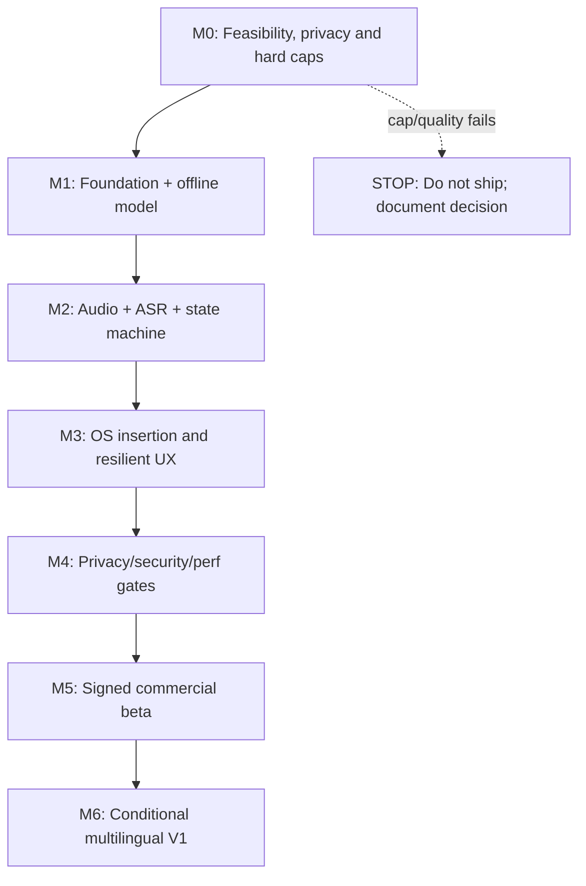
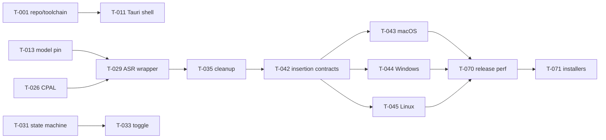

# TASKS.md — Dependency-Ordered Engineering Backlog

> **Status:** In progress; checkboxes remain open until evidence is accepted · **Revision:** 1.2 · **2026-11-03**
> **Product authority:** [PRD.md](PRD.md) · **Architecture:** [ARCHITECTURE.md](ARCHITECTURE.md) · **Technology:** [TECH_STACK.md](TECH_STACK.md) · **Behavior:** [USER_FLOWS.md](USER_FLOWS.md)

## 0. How agents should use this checklist

**Do not declare a task complete merely because code was written.** To check it, implementation must exist, a focused test must pass, an integration check must be recorded where relevant, and the requested artifact/evidence must be committed. Use one PR per small coherent batch (ideally 1–3 adjacent tasks), preserve ID references and leave unchecked items unchanged until verified.

- Task `T-xxx` is stable and immutable. If split, append subtask suffix like `T-026a`; do not renumber all task IDs.
- Dependencies (`Deps`) reference must-complete tasks unless explicitly marked `parallel`. A hard gate cannot be skipped without changing the PRD.
- Every task's `F-xx`, `C-xx`, `UF-xx`, and `AC-xx` point to exact definitions in companion files. Where appropriate, the milestone section supplies shared cross references.
- **No customer runtime model downloads. No model chooser. No cloud. No transcript history. No LLM in MVP.** Any proposed change that violates these constraints requires formal scope change before code.
- **Peak RSS+disk <950,000,000 bytes**, **4 GB physical RAM CPU-only** are release gates. Do not claim compliance from published vendor model parameters alone.
- An explicit `MODEL_DECISION.md` may be generated as **build evidence**, but the requested user-facing deliverables remain exactly these five documents.

### 0.1 Recommended agent workflow

1. Read all five files, then resolve the next earliest unchecked task whose dependencies are all done.
2. Inspect current repository and source docs; record assumptions in PR. Implement minimal change scoped to task.
3. Add or update unit/integration test and run formatter, linter, focused tests and relevant platform smoke.
4. Inspect diff and resource impact. For OS/FFI work run target-native tests; a mock alone is insufficient for hardware certification.
5. Write evidence to `evidence/T-xxx.md` with command, date/OS, expected vs observed, links to logs (redacted), and issue IDs.
6. Only then mark `[x]` in this file; never mark complete via a speculative code suggestion.

### 0.2 Prompt 79 execution note — partial native inference evidence

Prompt 79 verified a local-only Small Streaming model bundle by observed SHA-256, built the pinned Moonshine C API as an arm64 macOS dylib, confirmed exported stream lifecycle symbols, and ran two real fixture-backed C API streaming sessions with nonempty partial and final transcripts. The reproducible smoke harness and detailed record are `tests/native/moonshine_streaming_smoke.cpp`, `evidence/mvp/prompt-79-model-assets.json`, and `evidence/mvp/prompt-79-macos-dictation.md`. This evidence does **not** complete the app vertical slice: no Tauri shell, Rust binding, microphone capture, session state machine, cleanup integration, target validation, insertion, Copy Result, or offline app launch exists. No task checkbox is changed by this note.

Prompt 79C added a reusable 100 ms macOS/Linux process-tree RSS sampler, a privacy-preserving native ASR evaluator/result validator, stronger fixture and asset integrity checks, and build-scope/license evidence. The pinned Small model's eight local file hashes still validate (142,300,974 bytes), while its immutable artifact revision and redistribution approval remain unknown. The existing native smoke was rebuilt and again produced nonempty partial/final results in two sessions. Ten process-tree RSS runs reached 1,023,426,560 bytes; four exceeded the 950,000,000-byte threshold. This is the current native harness/library tree, not the complete Outflow app. The measured evaluator cannot run WER because the fixture manifest has zero ready references. The 18 GB M3 Pro is not the required physical 4 GB target. Accessibility trust is not granted, so no insertion controls were tested. The native library still includes optional TTS and diarization code; TTS-off failed at compile/link without changing pinned source. T-002, T-003, T-004, T-006, T-009, and T-010 remain incomplete. See `evidence/mvp/prompt-79c-detailed-implementation-handoff.md`, `evidence/model/MODEL_DECISION.md`, and `evidence/mvp/prompt-79c-native-license-audit.md` for exact results and remaining blockers.

Prompt 79D corrected the corpus coverage, physical 4 GB eligibility, actual macOS dyld identity, and measured-results pre-write validation. Ready fixtures now need independent duration and diversity attributes; 100 short + 50 long alone cannot pass. The evaluator requires exact physical bytes and an approved reference class; the allowlist is empty, and the 18 GB M3 Pro is ineligible. A standalone verifier confirmed the exact helper, Moonshine, and ONNX Runtime image identities for one arm64 development build. The native benchmark remains fail-closed at 0 ready fixtures, so there is no WER result. The paired 20-run memory matrix found default-thread RSS peaks up to 1,010,614,272 bytes; the upstream TSan/reliability-only single-thread switch peaked at 907,902,976 bytes but increased p95 session latency about 2.69× and is not adopted for production. Small remains `BLOCKED — INSUFFICIENT EVIDENCE`; Tiny is a source-inspected fallback only, not acquired or tested. The full test/evidence handoff is `evidence/mvp/prompt-79d-detailed-implementation-handoff.md` and `evidence/mvp/prompt-79d-native-memory-measurements.json`. T-002, T-003, T-004, T-006, T-009, and T-010 remain incomplete.

Prompt 79E adds an isolated development-only macOS AppKit/AVFoundation probe. Three real microphone permission/capture sessions completed: two produced nonempty partial and final results, while one captured 47.8 seconds without recognition. A device run exposed tap callbacks larger than the original audio block, so capture now splits callback frames into bounded queue blocks and has a targeted test. Ten real-time-paced fixture worker runs and two visible app fixture sessions also completed; one 30-second app-window RSS trace peaked at 919,814,144 bytes on this 18 GB host. These results are prototype evidence only; no human-reviewed reference or WER exists. Exact metadata from the third spoken session was saved without transcript or audio content. No production task checkbox changed: T-011, T-025–T-034, AC-06, and T-010 remain incomplete/blocked. The PRD's “4 GB” does not specify decimal versus binary bytes; classification now allows up to exactly 4,294,967,296 bytes for screening, while owner clarification, independently verified physical hardware, and the approved reference-class allowlist remain required. See `evidence/mvp/prompt-79e-detailed-implementation-handoff.md` and `evidence/mvp/prompt-79e-timed-fixture-measurements.json`.

Prompt 79F hardens cancellation in that isolated probe without changing the pinned Moonshine API or model. The permission completion now requires the same live request generation, session ID, Preparing state, open window, and a fresh AVFoundation Authorized check. Cancel invalidates permission, stops AVAudioEngine/fixture production before worker cancellation/join, clears queue samples and volatile preview/final fields, and rejects stale worker events; Dismiss joins terminal cleanup before returning to Idle. Native tests inject synchronization at model load, queue feed and final drain and run 100 worker plus state restart cycles; app source-contract tests cover the asynchronous permission and callback guards. The physical AppKit session verified live partial→Cancel clearing/release, Dismiss→new live session→Stop/final, and an early live Cancel. This remains prototype evidence only and does not complete any production task or release gate. Detailed sanitized outcomes and exact commands are in `evidence/mvp/prompt-79f-detailed-implementation-handoff.md`.

Prompt 79G adds a native AppKit Copy Result button to that development probe. A pure policy binds nonempty final text to the accepted ResultReady session; an injectable writer is called once only from the mouse/Return action, and lifecycle cleanup clears the volatile result. The fixture UI showed the button enabled after a recognized final result and disabled for a silent result; Return reached the guarded action. Automated policy/privacy checks pass, including unchanged Unicode/multiline pass-through, stale-session rejection and no lifecycle writes. A disposable synthetic sentinel appeared unchanged in one earlier no-click/failed-write check, but the final manual-selection/⌘C follow-up did not paste the expected fixture result; its blank TextEdit target received unexpected pre-existing clipboard content, so manual paste remains **not verified**. That unsaved target was discarded without saving, and the clipboard was not inspected further, cleared, or restored. NSPasteboard returned failure for the button action in this host. The source and fake-writer tests establish that no write is invoked during recognition or lifecycle handling, but successful button copy, a reliable final sentinel check, and manual paste are **not verified**. The test used the existing authorized model and fixture and changed no ASR/model/source ABI. This evidence is development-only: do not mark T-046, T-047, T-010, T-011, AC-10, or the MVP complete. See `evidence/mvp/prompt-79g-detailed-implementation-handoff.md` for exact validation and the remaining clipboard, microphone, and production blockers.

## 1. Milestone map / critical path



| Milestone | Dependencies | Exit evidence | Stop condition |
|---|---|---|---|
| M0 (P0) | None | Real Small/Tiny CPU-only WER, disk, process-tree RSS; OS integration matrix; license review | No bundled model meets simultaneous quality, 4 GB, <950 MB gates |
| M1 (P1) | M0 | Offline Tauri shell, pinned dependency graph, immutable bundled model manifest, build artifacts | Model not bundled; network needed to launch |
| M2 (P2) | M1 | 100 push/toggle cycles, stable ASR, 200 cleanup goldens, no silent audio leaks | Any data leaves computer; unbounded recording memory |
| M3 (P3) | M2 | Certified focus-safe insertion and fallback on supported OS targets; accessible UI | Wrong-target injection or secure-field violation |
| M4 (P4) | M3 | Audited native FFI, error recovery, memory/disk/battery verification, no telemetry | Performance or security gate fails |
| M5 (P5) | M4 | Signed/notarized verified installers; staged opt-in update; beta signoff | Unsigned updater, invalid licenses, lost rollback |
| M6 (V1) | M5 | Per-language quality AND aggregate hard caps, no model download | Combined languages exceed limits |

**Milestone estimates** for a small experienced team (not commitments): P0 1–2 weeks; P1 1–2; P2 2–3; P3 3–5; P4 2–4; P5 2–4; V1 only after research/fit.

## 2. Acceptance and test tools

Use Rust `cargo fmt`, `cargo clippy`, `cargo test`, plus MSVC/Apple Clang/GCC platform compilation, native ASan/UBSan for selected C/C++ builds, `cargo audit`, `cargo deny`, manifest hash verifier, JS `tsc --noEmit`, Vite build and WebView accessibility smoke. Each OS needs release-artifact packaging; a successful `cargo test` does not certify clipboard, permissions, keyboard hooks, code signing, memory, or installers.

**Proof paths (proposed):** `evidence/model/`, `evidence/perf/<os>-<hardware>/`, `evidence/security/`, `evidence/accessibility/`, `evidence/platform/<os>/`, `evidence/release/`, `tests/fixtures/`. No real customer audio in CI. Synthetic text only in screen recordings. A dedicated licensed audio fixture corpus may be locally accessible to CI, with distribution restrictions documented.

## 3. Dependency graph and platform work distribution



Parallel workers may edit separate crates behind a pinned trait interface after T-023/T-042. Do not simultaneously edit shared public traits or Cargo manifests without ownership; merge one change at a time, re-run `cargo check --workspace` and rerun all contract tests. Prefer separate Git worktrees/branches for simultaneous OS adapters.

## 4. Atomic dependency-ordered backlog

Each task includes the primary feature/acceptance link and concrete completion artifact. The list is dependency-ordered within milestones; platform-specific tasks may run in parallel after the interface is stable.

### M0 — Research, feasibility and security proof (no product release)

- [x] **T-001 — Initialize repository policies.** Deps: none. Create Rust workspace shell, contribution rules, `.editorconfig`, license/notice templates; pass formatting sanity. [F-01/C-01/AC-01]
- [ ] **T-002 — Confirm supported OS/CPU matrix.** Deps: T-001. List physical 4 GB target machines and exact OS/build; capture machine/CPU IDs with no personal data. [F-01/C-01/AC-01]
- [ ] **T-003 — Define benchmark fixture manifest.** Deps: T-001. Record audio corpus provenance, human references, normalization and 100+ speech phrases; version fixture hashes. [F-06/C-05/AC-06] Prompt 79D adds auditable duration and independent coverage attributes; only the 100-short/50-long counts plus quiet/noisy/accent-variety/names/technical/numbers/abbreviations/silence/provenance/human-review gates can report complete. The manifest still has 0 ready fixtures. Common Voice's current terms conflict with repository mirroring; LibriSpeech needs exact-file selection and human review. T-003 remains incomplete; see `docs/BENCHMARK_FIXTURES.md` and the Prompt 79D handoff.
- [ ] **T-004 — Implement process-tree RSS sampler.** Deps: T-002. Sample 100 ms, sum all app-owned PIDs including webview helpers; record native PSS/private where possible; unit-test aggregation. [F-01/C-10/AC-01] Prompt 79C added the standard-library macOS/Linux sampler and synthetic-snapshot tests. Prompt 79D records ten paired native runs per CPU/thread configuration on the 18 GB Mac: default max 1,010,614,272 bytes; reliability-only single-thread max 907,902,976 bytes. Prompt 79E additionally sampled one 30-second development AppKit process tree across two fixture sessions (919,814,144-byte peak); macOS physical-footprint/PSS, phase-specific cold/long/error coverage, and the full Tauri helper tree remain unmeasured, so T-004 remains incomplete.
- [x] **T-005 — Implement installed-byte counter.** Deps: T-001. Count recursive unpacked bytes including model, native libraries, notices; test symlink handling and double file references. [F-01/C-09/AC-01] Evidence: [T-005](../evidence/T-005.md). This completes the utility task only; AC-01 release-size measurement remains pending.
- [ ] **T-006 — Prove macOS text insertion constraints.** Deps: T-002. Test AX trust, target matching and 5 real editable/protected controls; record failures and API versions. [F-09/C-07/AC-09] Prompt 79C's read-only `AXIsProcessTrusted()` probe returned `AX_NOT_TRUSTED`; no control was targeted, so all five control cases remain blocked pending user-granted Accessibility permission and a suitable dev probe.
- [ ] **T-007 — Prove Windows insertion constraints.** Deps: T-002. Test `SendInput`/UIA and UIPI on 5 fields incl elevated case; no privilege bypass. [F-09/C-07/AC-09]
- [ ] **T-008 — Prove Linux X11/Wayland portal limitations.** Deps: T-002. Test shortcut press/release, injection capabilities and clipboard on GNOME/KDE; document capability table. [F-09/C-07/AC-09]
- [ ] **T-009 — Audit legal/model/runtime redistributability.** Deps: T-001. Verify Moonshine MIT streaming weights, native third-party notices, installer redistribution; produce license BOM. [F-01/C-09/AC-01] Prompt 79D proves the loaded native dyld images and adds the KISS FFT BSD-3-Clause text at `docs/licenses/KISS-FFT-BSD-3-Clause.txt`. ONNX Runtime source/binary provenance and full notices, TTS/G2P, VCTK and diarization data rights, model artifact identity, package destinations, and human/legal sign-off remain unresolved. See `evidence/mvp/prompt-79d-licensing-review.md`.
- [ ] **T-010 — Run ASR candidate go/no-go experiment.** Deps: T-002,T-003,T-004,T-005,T-009. Benchmark pinned Small vs Tiny quantized on 4 GB, CPU-only, memory/installed bytes/RTF/WER and cold/warm latency. Write signed-off MODEL_DECISION.md; **STOP if neither works**. [F-06/C-05/AC-06] Prompt 79D executes paired native CPU performance/RSS and cold/warm load tests. Default Small RSS still exceeds 950 MB, while the upstream single-thread reliability switch trades memory for ~2.69× p95 latency and remains unapproved for production. WER, approved 4 GB hardware, Tiny, full-app resources and redistribution are unresolved; `MODEL_DECISION.md` remains blocked.

### M1 — Build reproducible offline foundation

- [ ] **T-011 — Bootstrap Tauri 2 tray app.** Deps: T-001,T-010. App launches/offline tray starts; settings webview created lazily and destroyed on close. [F-01,F-11/C-01/AC-01]
- [ ] **T-012 — Pin Rust/TypeScript/Vite/Tauri dependencies.** Deps: T-001,T-010. Commit `rust-toolchain.toml`, lockfiles, exact crates/npm versions and reproducible `cargo check`. [F-01/C-01/AC-01]
- [ ] **T-013 — Vendor selected Moonshine C ABI and one model.** Deps: T-009,T-010. Pin true Git commit and exact model SHA-256/file list, write production manifest, bundle into every target; no placeholders. [F-01,F-06/C-09/AC-01]
- [ ] **T-014 — Create platform release-target build matrix.** Deps: T-012. Cross/host-specific build tasks compile with expected CPU ISA; no Python/Node runtime dependency. [F-01/C-01/AC-01]
- [ ] **T-015 — Implement signed model-manifest local verifier.** Deps: T-013. Verify SHA-256 and byte lengths; missing/corrupt leads to model-error code, never fetch. [F-01/C-09/AC-01]
- [ ] **T-016 — Configure strict Tauri capabilities/CSP.** Deps: T-011. No raw shell/fs/eval or remote frontend navigation; command allowlist test. [F-12/C-01/AC-12]
- [ ] **T-017 — Define local settings schema v1.** Deps: T-001. Settings DTO, defaults, validation, and migration behavior; unit tests. The schema, validation, JSON codec, version rejection, and read-only first-run initialization are implemented; the overall task remains incomplete pending migration behavior and T-001. [F-11/C-08/AC-11]
- [ ] **T-018 — Implement atomic configuration writer.** Deps: T-017. Restrictive file perms, temp+fsync+rename/rollback; simulate disk full. Unix implementation and injected failure tests are recorded in `evidence/T-018.md`; Windows owner-only ACL support remains blocked pending an approved implementation. Keep unchecked until the cross-platform task requirements are met. [F-12/C-08/AC-12]
- [ ] **T-019 — Build structured error-code types.** Deps: T-001. Type-safe errors from ARCHITECTURE §6.2; redact all content at formatting/log boundaries. [F-13/C-10/AC-13]
- [ ] **T-020 — Build offline end-to-end “Hello” probe.** Deps: T-011,T-015,T-016. Start with network denied, manifest available, indicator/test UI, no external calls; repeat on 3 OS. [F-01/F-12/C-01/AC-01]
- [ ] **T-021 — Test Tauri window lifecycle.** Deps: T-011,T-004. Close/reopen 100 times; verify webview helper memory released and no stray process. [F-11/C-01/AC-11]
- [ ] **T-022 — Resolve true dependency graph/ABI.** Deps: T-012,T-013. Compile locked workspace and C/C++ native library on supported platforms; verify actual ABI symbol names and package feature selections. [F-06/C-05/AC-06]
- [ ] **T-023 — Freeze platform/speech interface contracts.** Deps: T-017,T-019,T-022. Compile mock `SpeechBackend` and `TargetService` as in ARCHITECTURE; contract tests in pure Rust. [F-06,F-09/C-05,C-07/AC-06]
- [ ] **T-024 — Add release package asset checklist.** Deps: T-013,T-014. Automated check for bundled model, tokenizer, notices, native libs; fail missing assets. [F-01/C-09/AC-01]

### M2 — Audio, streaming recognition, cleanup and session correctness

- [ ] **T-025 — Implement microphone permission service.** Deps: T-023. Probe/request per OS and return explicit statuses; denied tests. [F-02/C-07/AC-02]
- [ ] **T-026 — Implement CPAL mic stream lifecycle.** Deps: T-023,T-025. Open on begin only, close on stop/cancel, select default/explicit device; backend smoke. [F-05/C-03/AC-05]
- [ ] **T-027 — Implement audio format conversion/resampling.** Deps: T-026. Handle device sample format, mono downmix, 44.1/48 kHz conversion, clipping, fixtures. [F-05/C-03/AC-05]
- [ ] **T-028 — Implement bounded SPSC buffer.** Deps: T-026. Preallocated queue; no allocation/blocking in callback; overflow signals fail-safe cancellation. [F-05/C-04/AC-05]
- [ ] **T-029 — Bind Moonshine C stream lifecycle.** Deps: T-013,T-022,T-027,T-028. Load/create/start/feed/poll/stop/drain/free; native memory ownership tests. [F-06/C-05/AC-06]
- [ ] **T-030 — Implement ASR worker scheduling.** Deps: T-029. Poll partials every measured 250–500 ms, final drain at stop, thread caps and cancellation; no callback inference. [F-06/C-05/AC-06]
- [ ] **T-031 — Implement explicit session reducer.** Deps: T-023. Session ID, event seq, state graph and valid transitions; test stale/duplicate event rejection. [F-03/C-02/AC-03]
- [ ] **T-032 — Register push-to-talk with release awareness.** Deps: T-031. OS-specific down/up, autorepeat guard, unsupported hold fallback; 100-cycle test. [F-03/C-02/AC-03]
- [ ] **T-033 — Implement toggle shortcut recording.** Deps: T-031. First press begin, second finish, key-up ignored; 100-cycle race test. [F-04/C-02/AC-04]
- [ ] **T-034 — Wire session actions to audio/ASR.** Deps: T-026,T-030,T-031,T-032,T-033. One stream, correct start/stop/cancel, no mic in Idle; end-to-end offline fixture. [F-03,F-04,F-05,F-06/C-02,C-03,C-05/AC-03]
- [ ] **T-035 — Implement deterministic whitespace/punctuation pipeline.** Deps: T-023. Ordered pure functions, Unicode handling, idempotence; ≥150 goldens. [F-07/C-06/AC-07]
- [ ] **T-036 — Implement Verbatim/Clean and filler policy.** Deps: T-035,T-017. Explicit isolated filler-only deletion and 50 additional goldens, protect proper nouns/numbers. [F-07/C-06/AC-07]
- [ ] **T-037 — Implement no-speech detection.** Deps: T-029,T-030. Silence/low-confidence policy prevents inserts on 50 silent/noise samples; avoid constant microphone gating. [F-05/C-04/AC-05]
- [ ] **T-038 — Implement vocabulary CRUD.** Deps: T-017,T-018. Limit 500 entries, 128 Unicode chars each, boundary-aware validation and save/load/delete tests. [F-08/C-08/AC-08]
- [ ] **T-039 — Implement vocabulary hints and post-correction.** Deps: T-029,T-035,T-038. Use Moonshine keyterms where supported and guaranteed deterministic postmap; 100 word boundary fixtures. [F-08/C-06/AC-08]
- [ ] **T-040 — Run 1,000-session ASR/cleanup endurance test.** Deps: T-034,T-036,T-037,T-039. Measure stability, no history, WER/latency/RTF, memory growth; fail violations. [F-05,F-06,F-07/C-05/AC-06]

### M3 — Native OS insertion, fallback and accessible UI

- [ ] **T-041 — Build onboarding permission checklist UI.** Deps: T-011,T-025. OS prompt rationale, Retry/System Settings/Skip insertion, Wayland limitations, keyboard navigation. [F-02/C-01/AC-02]
- [ ] **T-042 — Freeze target identity/commit-once API.** Deps: T-023,T-031. TargetSnapshot, secure/focus validation, idempotent insert state, partial failure taxonomy; mock tests. [F-09/C-07/AC-09]
- [ ] **T-043 — Implement macOS AX/Quartz adapter.** Deps: T-006,T-042. AX capability and secure field checks, Unicode insertion where allowed, consent status, real editor smoke. [F-09/C-07/AC-09]
- [ ] **T-044 — Implement Windows Win32/UIA adapter.** Deps: T-007,T-042. SendInput Unicode, UIA capability probe, equal/lower integrity, secure target tests. [F-09/C-07/AC-09]
- [ ] **T-045 — Implement Linux X11/Wayland adapter.** Deps: T-008,T-042. X11 supported targets; Wayland portal checks; clear unsupported status and no privileged injection. [F-09/C-07/AC-09]
- [ ] **T-046 — Implement copy-only result panel.** Deps: T-011,T-042. In-memory final result, explicit Copy, Dismiss and clipboard warning; no auto write. [F-10/C-07/AC-10]
- [ ] **T-047 — Implement clipboard adapter and failure UX.** Deps: T-046. Tested with permission denial, clipboard managers, Unicode; no write before user action. [F-10/C-07/AC-10] Prompt 79H corrected the development probe's explicit AppKit replacement path and added isolated-test coverage; its desktop attempt targeted an older no-arguments window. Prompt 79I adds a bounded development-only ID/PID in the app title and read-only label, launcher forwarding, and native rejection of malformed/repeated IDs. The 79I fixture copy reported AppKit success and TextEdit received nonempty text, but the in-memory comparison did not match; cause was undetermined. Prompt 79J adds an ID-required synthetic diagnostic using one fixed UTF-8 sample and the existing ResultReady eligibility/button/writer path, without microphone, worker, or model startup. Fresh ID/PID values were verified against the built executable for separate mouse and Return sessions. Each activation produced AppKit success and a new empty plain-text TextEdit document received a visually and accessibility-exact match; both unsaved documents were discarded. Dismiss cleared both results and disabled Copy. The controlled synthetic path is verified on this host, but it does not explain the earlier real-result mismatch. Focused native, isolated AppKit, and authorized real-fixture regressions pass; the real fixture is not a licensed WER corpus. This remains prototype evidence only: T-046, T-047, T-010, T-011, AC-10, and MVP completion remain open. See `evidence/mvp/prompt-79j-detailed-implementation-handoff.md`.
- [ ] **T-048 — Integrate commit/uncertain outcomes.** Deps: T-034,T-036,T-043,T-044,T-045,T-046. Validate target identity, insert once, never auto retry uncertain result; E2E. [F-09,F-10/C-02,C-07/AC-09]
- [ ] **T-049 — Build OS compatibility regression suite.** Deps: T-048. Real browser, IDE, native editor, password, remote/elevated, focus switch and Wayland cases. [F-09/C-07/AC-09]
- [ ] **T-050 — Implement runtime state indicator.** Deps: T-034,T-011. Ready/Preparing/Listening/Finalizing/CopyReady without focus stealing; reduced motion. [F-11/C-01/AC-11]
- [ ] **T-051 — Implement tray and settings navigation.** Deps: T-011,T-017,T-050. General/Mic/Shortcuts/Text/Privacy/About; no model/history page; UI smoke. [F-11/C-01/AC-11]
- [ ] **T-052 — Build shortcut and mic settings.** Deps: T-032,T-033,T-026,T-051. Device list, registration error, hold support display, conflict-safe rebind. [F-11/C-01/AC-11]
- [ ] **T-053 — Build vocabulary/settings editor.** Deps: T-038,T-039,T-051. Accessible CRUD, Clean/Verbatim toggle, error feedback and keyboard navigation. [F-08,F-11/C-01,C-08/AC-08]
- [ ] **T-054 — Implement complete onboarding demo flow.** Deps: T-041,T-048,T-051. First-run test field, offline instructions and recovery; screenshot with synthetic content. [F-01,F-02/C-01/AC-01]
- [ ] **T-055 — Screen reader and keyboard audit.** Deps: T-046,T-051,T-053,T-054. VoiceOver/Narrator-Orca where available, focus order/200% zoom/contrast/labels. [F-11/C-01/AC-11]
- [ ] **T-056 — Verify failure sequences.** Deps: T-048,T-055. Manual and scripted focus-loss, secure field, mic unplug, model error, collision; no content persistence. [F-13/C-07/AC-13]

### M4 — Privacy, resource and reliability hardening

- [ ] **T-061 — Enforce no-content logs.** Deps: T-019,T-034,T-048. Trace metadata only; no audio/transcript/vocabulary values in logs or panic handlers; static scan + tests. [F-12/C-10/AC-12]
- [ ] **T-062 — Verify zero ordinary network egress.** Deps: T-054,T-061. DNS blackhole/deny-all packet capture: install, first run, mic, settings, vocabulary, idle; no requests. [F-12/C-01,C-09/AC-12]
- [ ] **T-063 — Audit volatile audio/text lifecycle.** Deps: T-034,T-046,T-061. No persisted WAV/transcript, buffer release at stop/cancel, clipboard only explicit; state/file scans. [F-12/C-03,C-05/AC-12]
- [ ] **T-064 — Implement privacy-safe diagnostics export.** Deps: T-019,T-061. Version/error/performance metadata only; blocked transcript/vocab fields; deliberate export dialog. [F-13/C-10/AC-13]
- [ ] **T-065 — Build failure-injection suite.** Deps: T-056,T-064. Fault matrix ≥100 cases; graceful process recovery, no retry insertion, atomic settings. [F-13/C-02,C-10/AC-13]
- [ ] **T-066 — Native FFI and supply chain security audit.** Deps: T-029,T-061. Ownership, C API version, unsafe boundary review, fuzz/parser tests, license SBOM and advisory scans. [F-06,F-12/C-05/AC-12]
- [ ] **T-067 — Implement bounded memory pressure guard.** Deps: T-004,T-034. Detect capacity pressure and fail safely; no background model leaks, no OS OOM in 4 GB tests. [F-06/C-09/AC-06]
- [ ] **T-068 — Optimize release binary/webview size.** Deps: T-021,T-067. Profile `opt-level`/LTO, UI helpers, model mmap, thread caps, record changes and WER regressions. [F-01,F-06/C-01,C-05/AC-01]
- [ ] **T-069 — Conduct battery/CPU experiments.** Deps: T-068. 8 h idle A/B and active CPU/RTF; report thermal/OS controls and results; regressions filed. [F-06/C-05/AC-06]
- [ ] **T-070 — Enforce hard release resource gates.** Deps: T-040,T-049,T-068,T-069. Repeat per-OS installed footprint <950MB AND aggregate RSS <950MB, CPU-only 4GB; CI blocks release. [F-01,F-06/C-09,C-10/AC-01]

### M5 — Commercial packaging, policy and release

- [ ] **T-071 — Build direct installers including model.** Deps: T-024,T-070. macOS DMG/PKG, Windows MSI/NSIS, Linux DEB/RPM/AppImage as supported; offline reinstall tests. [F-01/C-09/AC-01]
- [ ] **T-072 — Implement explicit signed whole-app updater.** Deps: T-071,T-066. No automatic check; user-initiated TLS, signature enforcement, model included in update; rollback. [F-13/C-10/AC-13]
- [ ] **T-073 — Sign/notarize macOS bundle.** Deps: T-071. Developer ID/hardened runtime/notarization verified on clean OS; mic and AX preserved. [F-13/C-10/AC-13]
- [ ] **T-074 — Sign Windows installer.** Deps: T-071. Authenticode/trusted signing, SmartScreen reputation guidance; clean VM install and update check. [F-13/C-10/AC-13]
- [ ] **T-075 — Publish Linux checksum/signature policy.** Deps: T-071. Verified DEB/RPM/AppImage builds and native dependency docs; no elevated input hooks. [F-13/C-10/AC-13]
- [ ] **T-076 — Final third-party notices/license review.** Deps: T-066,T-071. License texts/models/native runtime attributions included; counsel/owner signoff. [F-01,F-13/C-09/AC-13]
- [ ] **T-077 — Final privacy/accessibility documentation.** Deps: T-055,T-062,T-076. Accurate no-history/offline/clipboard/OS limitations, legal scope and accessibility review. [F-12,F-13/C-10/AC-12]
- [ ] **T-078 — Conduct signed installer clean-machine beta.** Deps: T-072,T-073,T-074,T-075,T-077. Beta on physical 4GB per target; 100 cycles/OS, full AC sweep; crash/privacy checks. [F-01…F-13/AC-01…AC-13]
- [ ] **T-079 — Run go/no-go release review.** Deps: T-078. Signed evidence for AC-01–AC-13 and all NFRs; publish supported app/platform matrix; no open P0/critical. [F-01…F-13/AC-01…AC-13]
- [ ] **T-080 — Ship versioned release and recovery instructions.** Deps: T-079. Immutable signed artifacts and rollback metadata; validate public links/checksums and off-grid first run. [F-13/C-10/AC-13]

### M6 — V1 research and gated implementation (never required for MVP)

- [ ] **T-081 — Evaluate multilingual strategy.** Deps: T-079. Assess single bundled multilingual vs multiple in-app bundled models, model redistribution, per-language WER; **no downloads**. [F-14/C-05/AC-14]
- [ ] **T-082 — Benchmark combined language assets.** Deps: T-081. Measure all enabled language assets, cold and worst-case memory, disk and 4 GB hardware; stop if any hard cap fails. [F-14/C-09/AC-14]
- [ ] **T-083 — Implement language settings only if feasible.** Deps: T-082. Select from languages already bundled, no model download UI, no default remote detection, per-language fixtures. [F-14/C-05/AC-14]
- [ ] **T-084 — Design per-app profile schema.** Deps: T-079. Application IDs, default fallback, no document scanning, permission boundaries, migration tests. [F-15/C-08/AC-15]
- [ ] **T-085 — Implement and test per-app profiles.** Deps: T-084,T-083. Rules via target app ID and immutable session snapshot; no cross-app leakage; full end-to-end test. [F-15/C-06,C-07/AC-15]

## 5. Release milestones and definitions of done

### 5.1 Definition of done per feature

A feature F-xx is **Done** only when: (1) every mapped T-xxx is checked, (2) its AC-xx passes in test fixtures and on required hardware, (3) the corresponding UF-xx can be completed offline, (4) no privacy/security/platform permission regression, (5) all docs still cross-reference that exact behavior, and (6) the evidence bundle identifies build version, exact model hash and OS.

### 5.2 Definition of done per release

- **MVP feature acceptance:** AC-01 through AC-13 pass; AC-14/15 are V1-only.
- **Physical 4 GB:** tested in normal user session, with simultaneous settings window and active ASR during worst-case finalization. 4 GB VM alone is insufficient for broad certification.
- **Memory:** sum RSS of app process tree sampled every 100 ms, max <950,000,000 bytes during cold/warm/long/error. Track Windows private/working set, Linux PSS and macOS resident/footprint secondarily.
- **Disk:** installed app directory recursive bytes <950,000,000, including **all** bundled model files and native libraries. Document update staging exception separately.
- **No network for core use:** block DNS/traffic, observe zero connections from first launch, listening, transcripts, UI. Updater only after explicit command.
- **No content leakage:** no waveform/text in logs, diagnostics, crash payloads, storage; only user-entered vocabulary/settings persisted.
- **OS safety:** no wrong-target injection, protected/password injection, elevation bypass; copy fallback when capability absent.
- **Commercial:** correct model/native notices, signed installers, notarization, verified updater, documented support and legal/privacy review.
- **Accessibility:** keyboard-only + VoiceOver/NVDA/Orca smoke tests; WCAG 2.2 AA webview review.
- **Stability:** automated 1,000-session endurance without target miswrites or uncontrolled memory growth.

### 5.3 Progress tracking table (update in repository)

| Milestone | Task range | Status | Blocker | Evidence |
|---|---|---|---|---|
| M0 feasibility | T-001–T-010 | In progress | Native runtime identity is verified on one macOS arm64 dev build. Prompt 79E's separate development app tree peaked at 919,814,144 bytes on an 18 GB host; older native-only default-thread runs peaked at 1,010,614,272 bytes. No ready WER fixture, approved physical 4 GB reference machine, Tiny run, installed-size result, completed license approval, or full production-app resource evidence. Decimal/binary “4 GB” boundary needs owner clarification; approved class allowlist remains empty. | `evidence/mvp/prompt-79e-detailed-implementation-handoff.md`; `evidence/mvp/prompt-79e-timed-fixture-measurements.json`; `evidence/mvp/prompt-79d-detailed-implementation-handoff.md`; `evidence/model/MODEL_DECISION.md` |
| M1 foundation | T-011–T-024 | In progress | T-001/T-010 prerequisites and remaining M1 tasks | `evidence/build/` |
| M2 local speech | T-025–T-040 | Not started | Production tasks still require M1 and approved Rust/CPAL/Tauri integration. Prompts 79E/F are a separate Objective-C++ feasibility probe; they do not complete T-025–T-034 or AC-06. | `evidence/asr/`; `evidence/mvp/prompt-79e-detailed-implementation-handoff.md`; `evidence/mvp/prompt-79f-detailed-implementation-handoff.md`; `evidence/mvp/prompt-79-macos-dictation.md` |
| M3 OS UX | T-041–T-056 | Not started | Requires M2 interfaces | `evidence/platform/` |
| M4 hardening | T-061–T-070 | Not started | Requires E2E | `evidence/perf/` |
| M5 release | T-071–T-080 | Not started | Requires memory/quality gate | `evidence/release/` |
| M6 V1 | T-081–T-085 | Deferred | Requires signed MVP release | `evidence/v1/` |

## 6. Change control and agent execution rules

Changes impacting `F-xx` must include coordinated PR updates to `PRD` acceptance `AC-xx`, `USER_FLOWS` flow `UF-xx`, `ARCHITECTURE` component `C-xx`, `TECH_STACK` decision `TS-xx`, and impacted `TASKS` `T-xxx`. Do not turn “research later” into a runtime behavior. All performance claims require artifact and hardware evidence; all crate versions require upstream release verification and lockfile. If model selection changes, rerun quality/energy/memory/license tests on all certified OS/CPU combinations and replace the **bundled** asset with a signed full-app release.

**Security/irreversibility rule:** Never have an autonomous coding agent publish a release, purchase a signing certificate, rotate signing keys, grant OS permissions, or send an externally visible update without explicit human review and authorization. Local unit tests and reversible code changes are allowed. Real microphone/clipboard tests require test-machine setup and approved synthetic fixtures.

**Examples of completed task evidence:**

```yaml
task_id: T-030
commit: <git-commit>
platform: Windows 11 x64 / physical 4 GB
model_sha256_manifest: <committed manifest SHA>
commands:
  - cargo test -p speech-moonshine
  - cargo test -p app-core
measurements:
  p95_stop_to_final_ms: <measured>
  peak_process_tree_rss_bytes: <measured>
result: PASS | FAIL
notes: no transcript content in log
reviewer: <reviewer>
```

## 7. Sources

- [Rust release/toolchain history](https://blog.rust-lang.org/releases/)
- [Tauri 2 release stream](https://github.com/tauri-apps/tauri/releases)
- [Moonshine source/models/C API](https://github.com/moonshine-ai/moonshine) and [C API documentation](https://moonshine-voice.readthedocs.io/en/stable/api/c-api/)
- [Moonshine benchmarks](https://moonshine-voice.readthedocs.io/en/stable/using/benchmarks/)
- [CPAL](https://docs.rs/crate/cpal/latest), [rubato](https://docs.rs/crate/rubato/latest), [ringbuf](https://docs.rs/crate/ringbuf/latest/builds)
- [XDG desktop portals](https://flatpak.github.io/xdg-desktop-portal/docs/)
- [Apple accessibility trust](https://developer.apple.com/documentation/applicationservices/1459186-axisprocesstrustedwithoptions)
- [Microsoft SendInput/UIPI](https://learn.microsoft.com/windows/win32/api/winuser/nf-winuser-sendinput)
- [Tauri signed updater](https://v2.tauri.app/plugin/updater/)
- [NIST SSDF](https://csrc.nist.gov/pubs/sp/800/218/final)
