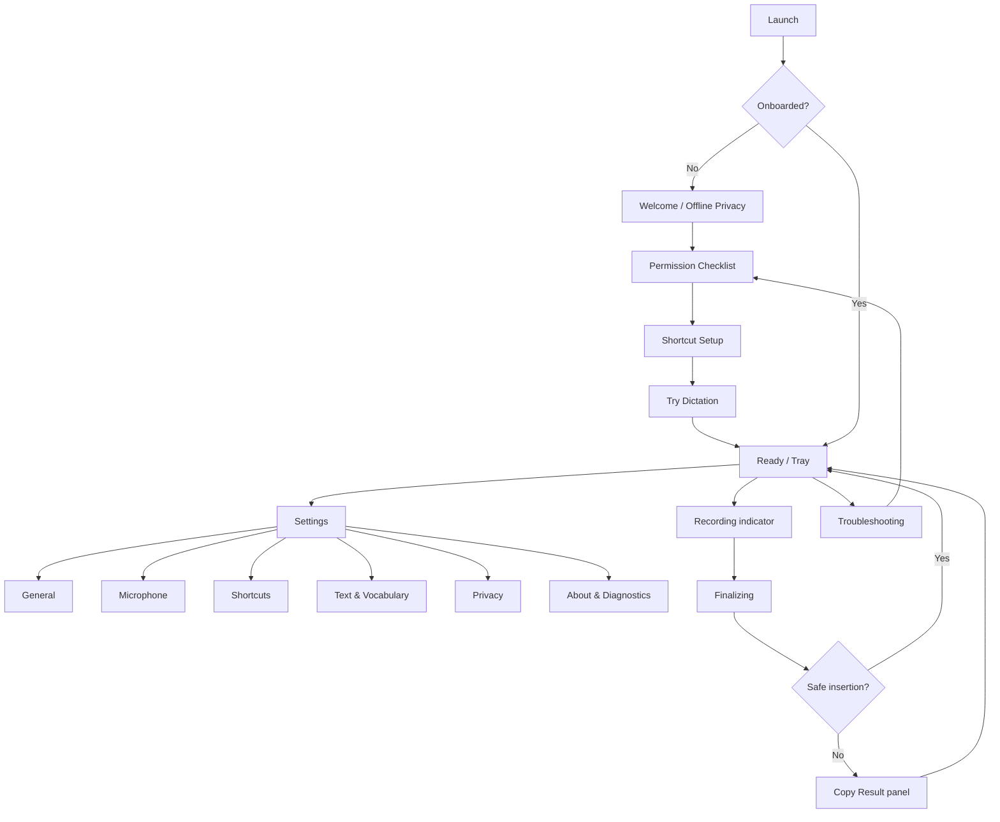
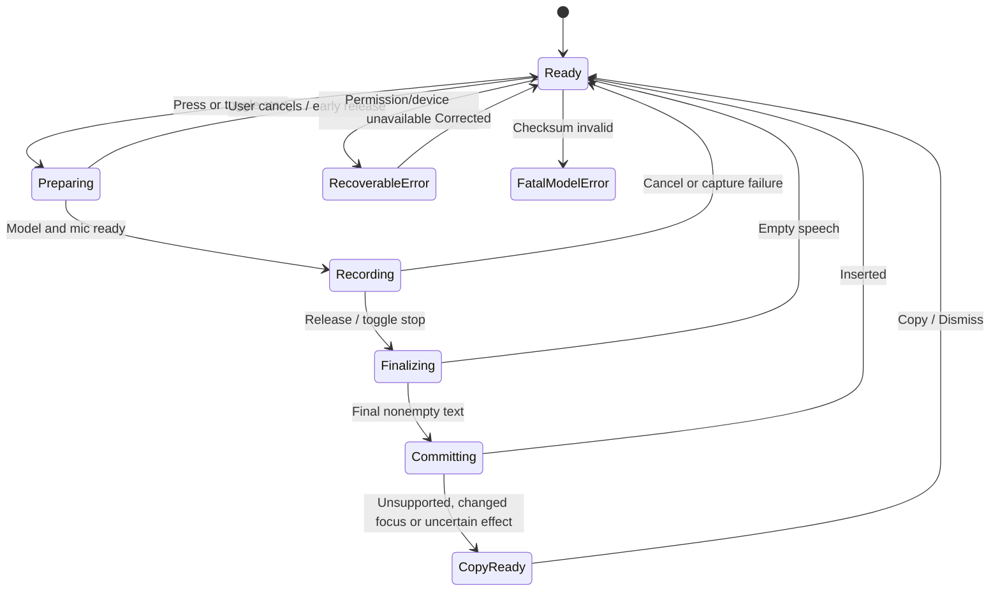
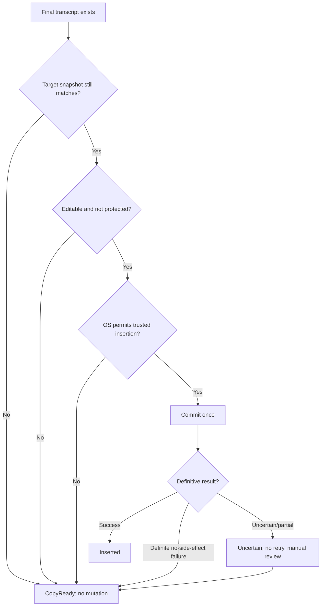
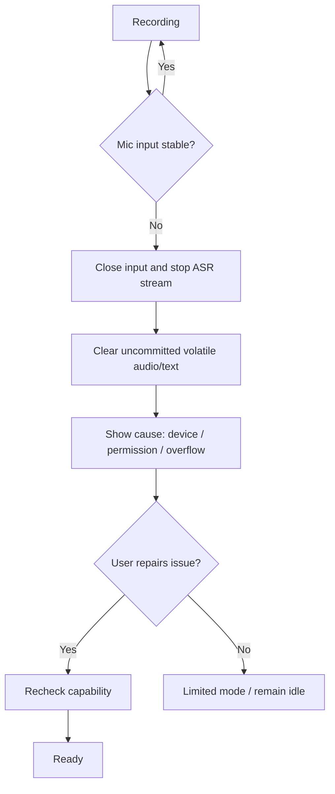
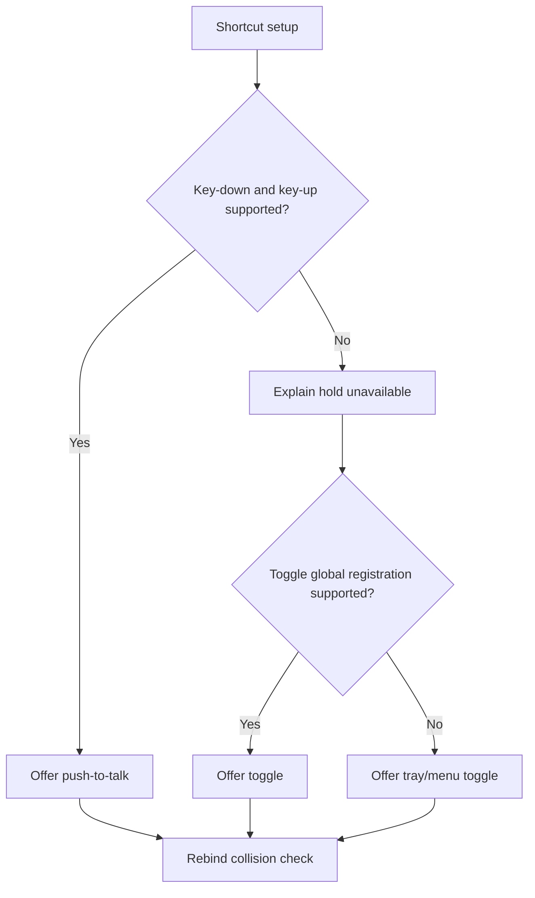

# USER_FLOWS.md — Detailed Journeys, Interaction States and Recovery Paths

> **Status:** Executable UX contract | **Cutoff:** 2026-10-29  
> **Product:** [PRD.md](PRD.md) · **Components:** [ARCHITECTURE.md](ARCHITECTURE.md) · **Decisions:** [TECH_STACK.md](TECH_STACK.md) · **Tasks:** [TASKS.md](TASKS.md)

## 0. Universal UX principles

1. Users never need an account, Internet, model download, model picker or transcript history. The single English ASR model ships in each installer, and offline first use works.
2. Opening the microphone requires an intentional supported action. Recording status must remain visible/discoverable. No hot mic while idle.
3. A transcript is **never** automatically inserted until it is final and both target identity and permissions are verified. No automated replay after ambiguous insertion.
4. Fallback is **an app-owned in-memory result panel with explicit Copy**, never silent clipboard overwrite.
5. Push-to-talk is offered only if the OS integration provides reliable press AND release events. Wayland portal limitations may require toggle via tray.
6. Unsupported OS features are surfaced honestly; do not request admin/root access, trust bypasses, or unsafe OS hacks.
7. Shortcuts, buttons and actions are reachable without a mouse. OS dialogs remain native; users can resume onboarding after changing OS permissions.
8. The app uses less than 1 GB of installed disk and aggregate peak RSS on a 4 GB system **only if verified by release testing**; otherwise release is blocked. [PRD §5](PRD.md#5-formal-measurable-acceptance-criteria).

## 1. Navigation and screen map

**Settings tabs:** General (auto-start opt-in), Microphone (system default/available input), Shortcuts (push/toggle status), Text & Vocabulary (Clean/Verbatim, replacements), Privacy (what is/not stored; update opt-in), About & Diagnostics (license notices, export diagnostics, explicit check for signed full-app update). **No** history page, model page, cloud preferences, prompts library, transcribed conversations, chat, or LLM settings.

### 1.1 UX copy contracts

| State | Primary text | Available action | Avoid |
|---|---|---|---|
| Ready | “Ready to dictate” | Hold shortcut / toggle | Implied background listening |
| Loading | “Preparing offline speech recognition…” | Cancel | Internet spinner/download suggestion |
| Listening | “Recording locally” | Stop / Cancel | Color-only indicator |
| Finalizing | “Finishing transcription…” | Wait / Cancel if not committing | Falsely “sent” |
| Inserted | “Text inserted” | Dismiss | Showing a transcript history |
| No speech | “No speech detected” | Try again | Inserting punctuation-only text |
| Denied mic | “Microphone access is off” | Open Settings / Retry | Repeated OS prompt loop |
| CopyReady | “Couldn't safely insert in that field” | Copy / Dismiss | Automatic clipboard overwrite |
| Secure field | “Dictation cannot type into protected fields” | Copy with explicit acknowledgement / Dismiss | Secure-target injection |
| Model corrupt | “Speech engine files failed validation” | Reinstall / Diagnostic code | Download model |
| Memory cap failure | “Device resources are insufficient for this session” | Close settings / Retry later | Crash or cloud switch |

## 2. User states and transitions

**App states:** `Booting`, `NeedsPermissions`, `Ready`, `Preparing`, `Recording`, `Finalizing`, `Committing`, `CopyReady`, `RecoverableError`, `FatalModelError`, `Exiting`.

**Session states:** `Idle`, `Loading`, `Listening`, `Finalizing`, `Committing`, `CopyReady`, `Inserted`, `Cancelled`, `Uncertain`, `Faulted`. UI labels and session states are related but not identical; `Committing` is brief and not user-editable.

**Atomic UX guard:** A tap intended for push-to-talk cannot be interpreted as an entire long recording simply because model loading takes time; release during Loading aborts or finalizes only already captured speech. Repeat key-down/up events and rapid toggles are idempotent.

## 3. Feature-to-flow matrix

| Product feature | Journey(s) | Architecture | Tasks anchor | Acceptance |
|---|---|---|---|---|
| F-01 | UF-01 | C-01,C-09 | T-011,T-013,T-071 | AC-01 |
| F-02 | UF-02 | C-01,C-07 | T-025,T-041 | AC-02 |
| F-03 | UF-03 | C-02,C-03 | T-031,T-032 | AC-03 |
| F-04 | UF-04 | C-02,C-03 | T-033 | AC-04 |
| F-05 | UF-03,UF-04 | C-03,C-04 | T-026,T-027,T-028 | AC-05 |
| F-06 | UF-05 | C-05,C-09 | T-013,T-029,T-030 | AC-06 |
| F-07 | UF-05 | C-06 | T-035,T-036 | AC-07 |
| F-08 | UF-06 | C-06,C-08 | T-038,T-039 | AC-08 |
| F-09 | UF-07 | C-07 | T-042,T-043,T-044,T-045 | AC-09 |
| F-10 | UF-08 | C-07 | T-046,T-047 | AC-10 |
| F-11 | UF-09 | C-01,C-08 | T-051,T-052,T-053 | AC-11 |
| F-12 | UF-10 | C-01…C-09 | T-061,T-062,T-063 | AC-12 |
| F-13 | UF-11,UF-12 | C-01,C-09,C-10 | T-064,T-065,T-072 | AC-13 |
| F-14 | UF-13 | C-05,C-09 | T-081,T-082,T-083 | AC-14 |
| F-15 | UF-14 | C-06,C-07,C-08 | T-084,T-085 | AC-15 |

## 4. Detailed main user journeys

### UF-01 — Install and cold offline first run (F-01)

**Actor:** new user, no network. **Preconditions:** supported OS/architecture and verified installer with bundled model. **Trigger:** launch after installation. **Navigation:** Installer → Welcome → Privacy → Permissions → Shortcuts → Try Dictation → Tray Ready.

1. Verify OS signature/publisher, install app (includes model). Unpacked installed size must meet AC-01.
2. Launch while Wi-Fi disabled. App reads bundled manifest and checks all file SHA-256 hashes from local files.
3. Intro says: “Speech stays on this device. No account. No transcript history.” No login/online spinner.
4. Begin UF-02 permissions. User can skip nonessential insertion permission and use Copy-only.
5. Configure shortcut, test in a known safe native edit field, receive text, finish onboarding.
6. Settings defaults are stored locally only. Closing settings destroys webview; tray remains.

**Alternative:** offline install lacks a library or model file → blocking FatalModelError with reinstall. **Postcondition:** local-only dictation ready or explicit limited mode, no network dependencies.

### UF-02 — Permissions and recovery (F-02)

**Preconditions:** first-run or permission revoked. **Triggers:** permission checklist, first dictation, or OS revocation.

1. Explain why mic permission is required and that it only opens during recording. User selects Allow → OS dialog.
2. Check permission status. On denial show “Open System Settings” when supported and keep recording disabled.
3. Explain insertion/accessibility separately; do not claim it is needed for Copy-only mode.
4. Register or prompt for shortcut capability (portal on Wayland). If unavailable, show tray-toggle alternative.
5. After returning from System Settings, refresh status on app focus/retry; do not assume grant until OS confirms.
6. Mark each capability `granted`, `denied`, `limited`, `unsupported`, or `needs_action`.

**Recovery:** user denies twice → no repetitive prompts; explicit Retry. **AC:** AC-02.

### UF-03 — Push-to-talk dictation (F-03,F-05)

**Preconditions:** ready, microphone allowed, key-up events supported, editable target in foreground. **Trigger:** user presses/holds configured shortcut.

1. On initial key-down, capture target identity and allocate session ID. Ignore autorepeat.
2. If model unloaded, enter Preparing and warm model; a release before actual capture aborts safely.
3. Enter Recording, open mic, display non-focus-stealing indicator, route buffered audio to model.
4. Partial transcript updates are allowed only in private indicator and are not inserted into target.
5. On key-up, close mic; final drain; deterministic cleanup; validate focus and protected field. If eligible, insert once and display success.
6. Clear volatile transcript/audio state. No history.

**Failure branches:** mic device lost → cancellation; secure field or focus change → UF-08; silence → no text; shortcut conflict → UF-09 configuration. **AC:** AC-03,05,06,07,09.

### UF-04 — Toggle recording (F-04,F-05)

**Preconditions:** ready with mic. **Trigger:** toggle shortcut or tray Start.

1. Activate toggle: start recording. Key-up ignored.
2. Continue as user speaks; UI displays elapsed time and Stop/Cancel options without keeping settings webview open.
3. Activate toggle again or press Stop: finalize and commit through UF-05/07.
4. Escape/Cancel: close mic and discard buffers, no insertion or history.

**Alternatives:** push shortcut while toggled -> no second session; microphone device disconnected -> end without insertion and show retry. **AC:** AC-04,05.

### UF-05 — Recognition and cleanup (F-06,F-07)

**Background interaction:** user sees only Recording → Finalizing; all technical actions are local.

1. Capture mono samples. Resample as required. Audio queue is bounded; on overflow cancel rather than emit corrupted text.
2. ASR receives PCM; produces partial revisions, followed by a final stable transcript after stop/drain.
3. If no valid speech, return No speech detected. Never synthesize a transcript from silence.
4. Apply ordered deterministic transformations: whitespace, explicit newline commands, word-boundary vocabulary replacements, punctuation/capitalization, optionally filler deletion in Clean mode.
5. Validate length and Unicode; produce final text for insertion/fallback. Never call an LLM, network or external shell.

**Example:** Input “um so i met north parkade at three” + vocabulary `north parkade → North Parkade` → Clean output “So I met North Parkade at three.” This is **illustrative**, and the actual golden corpus determines transformations; avoid semantic changes.

**AC:** AC-06,07. **Privacy:** raw audio and all transcripts remain in volatile memory until dismissed/committed.

### UF-06 — Manage custom vocabulary (F-08)

**Navigation:** Tray → Settings → Text & Vocabulary → Add/Edit/Delete.

1. User enters `spoken` and `written` phrase, sees live deterministic preview using a **synthetic example** (not prior transcripts).
2. Validate max 500 entries, case-insensitive uniqueness, 128 Unicode scalar value length, nonempty content, safe word-boundary behavior.
3. Save atomically to local config. During subsequent recognition, supply keyterm hints when supported; post-correction remains definitive.
4. Edit/delete immediately changes future sessions; sessions underway continue with their versioned immutable configuration snapshot.
5. Export/delete vocabulary through local user-directed file dialog; no network.

**Error:** conflicting source term → actionable validation error. **AC:** AC-08.

### UF-07 — Safe insertion to target (F-09)

**Preconditions:** finalized nonempty transcript and saved target snapshot.

1. Platform adapter checks target window/control is still current and editable, not password/secure or elevated/protected.
2. Prefer supported direct text mutation where safe. Otherwise a permitted keyboard injection mechanism may insert Unicode at cursor.
3. Success is returned only when a verifiable effect is observed; uncertain partial side effects go to `Uncertain`, not auto retry.
4. On definite unsupported target or mismatch, do not insert; go to UF-08. No restoring old focus by stealing user focus automatically.

**Hard cases:** target app closed during dictation; switching tabs; modal dialog; remote desktop; app hangs; composer lost focus; emoji/combining Unicode; clipboard manager; Windows UIPI; Wayland without portal. **AC:** AC-09.

### UF-08 — Copy-ready fallback (F-10)

**Trigger:** direct injection denied/unsafe/unsupported, target changed, or uncertainty. **Navigation:** Mini Result panel → Copy or Dismiss.

1. Present final text in a selectable, screen-reader-labeled in-memory panel, along with reason.
2. Clipboard is unchanged on panel open. User explicitly clicks Copy/keyboard shortcut; app writes text to clipboard once.
3. Display reminder: other OS apps/clipboard managers may retain copied text. User pastes manually.
4. Dismiss clears in-app result buffer; no history or crash log persistence.
5. If copying fails, user can still select text in panel; leave prior clipboard alone.

**Secure field nuance:** protected input never receives auto injection; exposing text in clipboard still requires user acknowledgement. **AC:** AC-10.

### UF-09 — Tray, settings, shortcuts and accessibility (F-11)

**Navigation:** tray Ready → Settings → tabs; status icon indicates Ready, Preparing, Recording, Error.

1. Keyboard user opens tray and settings, navigates tabs with Tab/arrow keys and visible focus.
2. Rename/rebind global shortcut with collision validation; show OS-specific press/release support; fallback to toggle if push unsupported.
3. Select system-default or explicit input device; test mic with visual level only **during test**.
4. Toggle Clean/Verbatim, start-at-login opt-in, and check for full-app updates only via explicit action.
5. Close settings: webview destroyed; recorder service stays ready with no mic open.
6. Quit: stop active mic, abort session, release model, exit; no stored transcripts.

**Accessibility:** visible labels, screen-reader names, 200% text scale, reduced motion, no color-only state, high-contrast. **AC:** AC-11.

### UF-10 — Privacy audit and off-grid usage (F-12)

1. User installs with disconnected network and dictates multiple sessions.
2. No network request, analytics, account, transcript storage or “download model” UI appears.
3. Diagnostics log records non-content status/error codes only; user can open Privacy tab and read disclosure.
4. Optionally explicitly check signed full-app update; only then may limited network connection occur.
5. Reset settings deletes vocabulary/settings locally (system clipboard and target app outside app control).

**AC:** AC-12. **Limitations disclosed:** OS destination app, swap, clipboard managers may retain content outside this app's control.

### UF-11 — Diagnostics and incident recovery (F-13)

1. Trigger structured error (mic denied, device lost, corrupt model, memory budget exceeded, capture overflow, focus uncertain).
2. Display human-friendly short explanation and suggested recovery. No transcript/log text content.
3. User may choose Troubleshooting → Export diagnostics (manual file-save dialog). Export: app version, OS, capability results, model checksum result, resource counters, anonymized error codes, time deltas.
4. On repair (device replug/permission change/reinstall), recheck and return to Ready. Never repeat uncertain insertion automatically.

**AC:** AC-13.

### UF-12 — User-initiated signed full-app update (F-13)

1. User opens About → Check for Updates. Display that this may connect to the vendor release host.
2. App checks signed metadata over TLS; verify signature. If absent, show “Up to date” or error, no retry loop.
3. If update available, explain download size **includes the built-in speech model** and prompt Install.
4. Preflight disk, ensure microphone stopped; download signed whole-app update (not separate model).
5. Verify signature/hash, install with platform-supported recovery/rollback; restart and revalidate bundled model.
6. On failed verification/interruption, keep previously signed version.

**AC:** AC-13. Full-app updater network is optional and does not weaken offline dictation.

### UF-13 — V1 bundled language support (F-14)

**Release gate:** V1 language set ships only after hard RSS/disk and accuracy checks. The app still has no model picker/download or runtime model fetch. If a single multilingual model supports the set, Settings may expose language selection (a **language selector**, not a **model selector**). A user may switch among already bundled languages with no network. On absent/unsupported language, explicitly say not included in this release. **AC:** AC-14.

### UF-14 — V1 per-app preferences (F-15)

Select installed app identifier from permission-appropriate running app list or manually specify application ID; configure Clean/Verbatim and vocab mapping. On target app change mid-recording, use original versioned settings snapshot and abort direct insertion if target differs. Never inspect editor content to classify application. **AC:** AC-15.

## 5. Interaction and recovery diagrams

### 5.1 Focus validation

### 5.2 Audio or permission fault

### 5.3 Shortcut capability

## 6. Edge-case inventory

| Case ID | Trigger | Required UX result | Related flow |
|---|---|---|---|
| E-01 | App launched with no network | Onboarding and dictation work | UF-01 |
| E-02 | Missing bundled model | Fatal reinstall guidance, no fetch | UF-01,UF-11 |
| E-03 | Installer corrupted model hash | Disable ASR, diagnostic code | UF-01 |
| E-04 | Mic permission denied first run | Retry/system settings; no capture | UF-02 |
| E-05 | Permission revoked while active | Abort cleanly, no insert | UF-02,UF-11 |
| E-06 | Global shortcut already registered | Rebinding instruction, no crash | UF-02,UF-09 |
| E-07 | Held shortcut OS never sends release | Do not offer push-to-talk | UF-03 |
| E-08 | Shortcut autorepeat | Ignore duplicate begins | UF-03 |
| E-09 | Key released during ASR loading | Cancel or finalize captured audio; no stuck mic | UF-03 |
| E-10 | Two toggles within 100 ms | Single deterministic state transition per event | UF-04 |
| E-11 | Push while toggle session active | Show already recording | UF-03,UF-04 |
| E-12 | Silence / noise only | Empty result, no insert | UF-05 |
| E-13 | Continuous speech without pause | Bounded processing, explicit stop, no infinite buffer | UF-05 |
| E-14 | Mic sample-rate changes | Reconfigure or abort safely | UF-05 |
| E-15 | Mic unplugged | Device lost → recover | UF-11 |
| E-16 | Audio callback overflow | Fail safe, error without garbage text | UF-05,UF-11 |
| E-17 | CPU thermal throttling | Display resource notice, terminate at watchdog threshold | UF-11 |
| E-18 | Windows memory pressure / OOM risk | Release worker/model, no crash loop | UF-11 |
| E-19 | Vocabulary exact collision | Validation error, preserve old entry | UF-06 |
| E-20 | Replacement inside longer word | Word boundaries protect text | UF-06 |
| E-21 | Unicode combined characters/emoji | Preserve exact codepoints where possible | UF-07 |
| E-22 | Dictation into password field | Never auto-insert | UF-07,UF-08 |
| E-23 | Focus moves to another tab | CopyReady; never wrong-target paste | UF-07 |
| E-24 | Target app closes | CopyReady | UF-07 |
| E-25 | Elevated Windows target | UIPI-limited; CopyReady | UF-07 |
| E-26 | GNOME Wayland lacks RemoteDesktop | CopyReady and limitation | UF-08 |
| E-27 | Wayland shortcut portal lacks hold/release | Toggle via tray | UF-03,UF-09 |
| E-28 | Clipboard access denied | Keep selectable result in panel | UF-08 |
| E-29 | Clipboard manager sync enabled | Warning before Copy | UF-08 |
| E-30 | Settings window closed while recording | Recording continues without losing target | UF-09 |
| E-31 | OS restarts microphone service | Error + manual retry; do not restart mic silently | UF-11 |
| E-32 | App crashes after partial insertion | On restart never replay session | UF-11 |
| E-33 | Update signature invalid | Reject, leave old app intact | UF-12 |
| E-34 | Update interrupted or out of disk | Rollback/recover | UF-12 |
| E-35 | Full-app update includes larger model | Must pass resource and disk release gates first | UF-12 |
| E-36 | User wants transcript history | Explain none exists; user can save in destination app | UF-10 |
| E-37 | User looks for model download | No such menu exists | UF-09 |
| E-38 | Login/startup UI when offline | No sign-in or network prompts | UF-01 |
| E-39 | App exit while recording | Close mic and discard uncommitted content | UF-09 |
| E-40 | Screen reader using keyboard | Full flow reachable with accessible names | UF-09 |
| E-41 | Model runtime error | Safe abort and error; no remote inference | UF-11 |
| E-42 | OS clipboard cannot write | Selectable result panel, no data loss in app until dismiss | UF-08 |

## 7. User-flow test specification

Each UF is a deterministic end-to-end scenario: unique test ID `E2E-UF-xx`, setup with mock native platform service for CI, then at least one platform-real acceptance run (when hardware available). Capture test evidence: screen recording **using synthetic text only**, accessibility tree, network capture showing no egress, process memory/installed footprint, logs without dictated content, and result assertions.

- **E2E-UF-01/02:** fresh install disconnected, permission grant/deny/regrant and system-settings flow.
- **E2E-UF-03/04:** 100 start/stop/cancel cycles, duplicate key-down, key-up while loading, no mic in Idle.
- **E2E-UF-05:** frozen 200-case cleanup corpus, clean/noisy accented reference audio, WER/latency benchmarks.
- **E2E-UF-06:** 500 vocabulary entries and 100 boundary/case/concurrency tests.
- **E2E-UF-07/08:** 100 insertion tests in supported editors, focus mutation, protected fields, uncertainty, explicit clipboard behavior.
- **E2E-UF-09:** VoiceOver/NVDA/Orca accessibility, tab order, 200% scaling, webview lifecycle.
- **E2E-UF-10:** first launch/recording w/ DNS blocked; inspect directories, socket traffic, logs.
- **E2E-UF-11/12:** fault injection, diagnostic redaction, invalid update signing/rollback.
- **E2E-UF-13/14:** V1-only language and per-app profile tests with both 950 MB gates.

**Gate mapping:** [PRD §5](PRD.md#5-formal-measurable-acceptance-criteria); [TASKS §5](TASKS.md#5-release-milestones-and-definitions-of-done).

## 8. References

- [Moonshine streaming model and C API](https://moonshine-voice.readthedocs.io/en/stable/api/c-api/).
- [Apple Accessibility permission check](https://developer.apple.com/documentation/applicationservices/1459186-axisprocesstrustedwithoptions).
- [Microsoft SendInput security restrictions](https://learn.microsoft.com/windows/win32/api/winuser/nf-winuser-sendinput).
- [XDG GlobalShortcuts](https://flatpak.github.io/xdg-desktop-portal/docs/doc-org.freedesktop.portal.GlobalShortcuts.html).
- [XDG RemoteDesktop / libei input control](https://flatpak.github.io/xdg-desktop-portal/docs/doc-org.freedesktop.portal.RemoteDesktop.html).
- [WCAG 2.2 accessibility guidance](https://www.w3.org/TR/WCAG22/).
- [Tauri updater and signature verification](https://v2.tauri.app/plugin/updater/).
